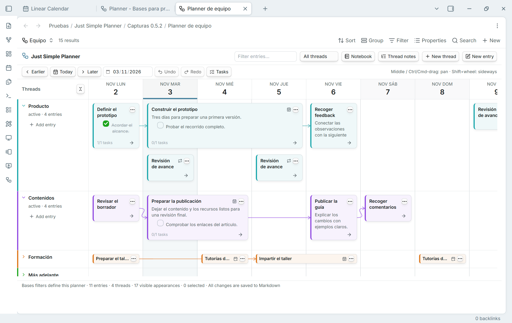
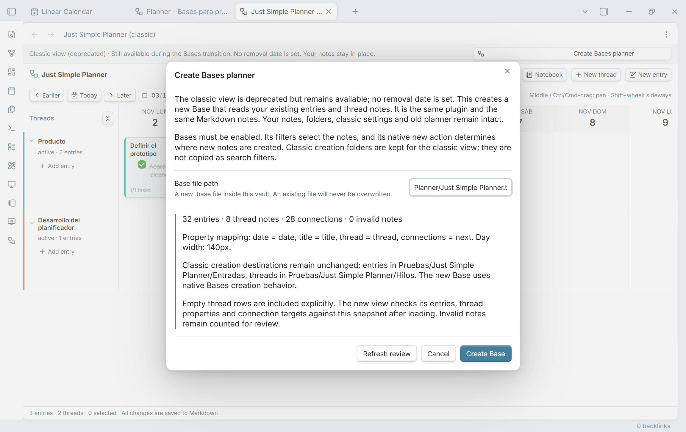
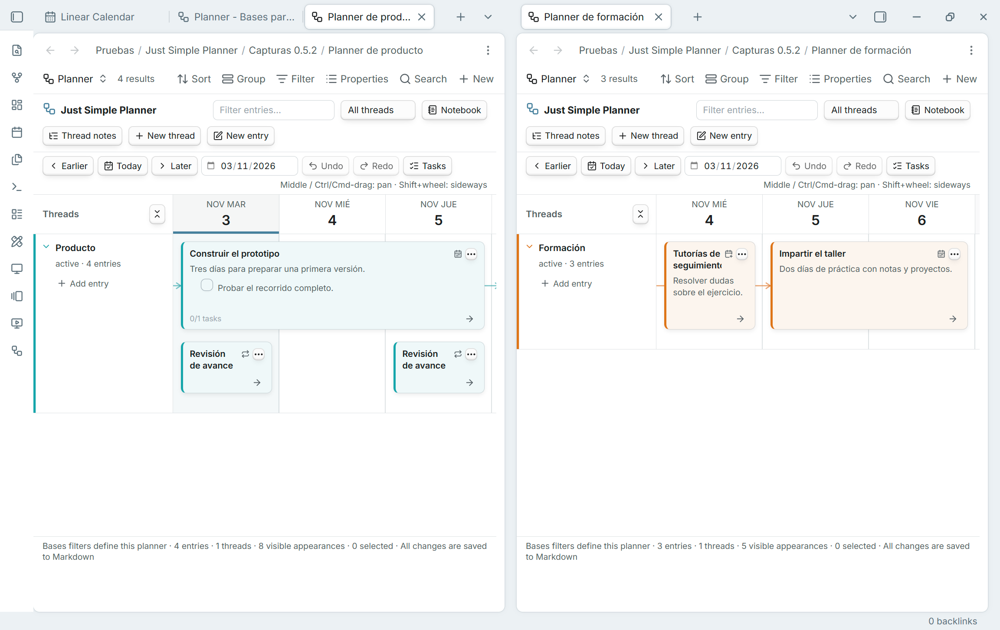
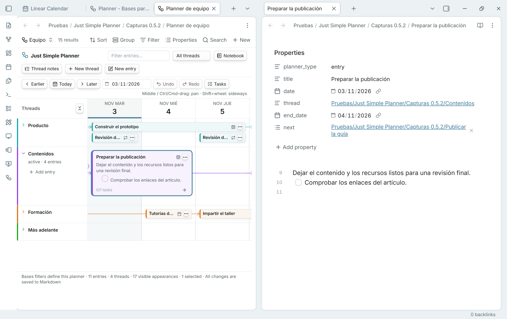

## Plan inside Bases, with the same Markdown notes

Just Simple Planner 0.5.2 adds **Simple Planner as a native Obsidian Bases layout**. Keep several planners in separate Base files or views, choose their notes with Bases filters, and configure date/title/thread/connections properties per view. Threads, arrows, the editor, Spotlight, Notebook, Tasks and undo/redo remain part of the planner.

## Important for existing users: classic is deprecated, still available

**The standalone classic view is deprecated. The plugin is not.** This is an update to the same `just-simple-planner` plugin ID. Both views are included in this release; existing classic tabs, settings, command IDs and Markdown notes are retained. The ribbon icon still opens **Open classic planner**.

**No removal date has been set.** Retirement is planned after the Bases transition is validated. You can compare the new planner with classic during this transition. There is no separate replacement plugin to install and no automatic conversion of your notes.

### Migrate your classic planner

1. Update the same plugin and enable **Bases** in Core plugins. If Bases was previously disabled, reload Just Simple Planner.
2. Run **Just Simple Planner: Create Bases planner from classic notes**, or use **Create Bases planner** in the classic banner / **Review migration** in settings.
3. Review the entry/thread/connection counts, property mapping and creation destinations. Choose a **new vault-relative `.base` path**, then click **Create Base**.
4. Wait for **Migration verified** before changing the initial query. The new view compares entry titles/dates, thread membership, connection targets and thread metadata, retaining empty thread rows.
5. Compare your normal workflow, then tailor the filters or add other planners. Select optional scheduling properties explicitly in Configure view.

Migration creates a new Base that reads the original files. **It does not move, rename, duplicate or rewrite your notes or replace classic settings.** The initial query uses existing entry/thread markers across the vault. Classic creation folders are not copied as folder filters; new note creation follows Bases instead.

Read the **[complete migration guide](https://github.com/DavidHurtadoAI/just-simple-planner/blob/0.5.2/docs/MIGRATION.md)** or **[guía completa en español](https://github.com/DavidHurtadoAI/just-simple-planner/blob/0.5.2/docs/MIGRACION.es.md)** for differences, missing-note checks, creation behavior and returning to classic.

## New in the Bases layout

- **Several planners:** independent Base queries and per-view settings/history. A note can appear in more than one planner without being copied. Views choosing the same note property share its changes.
- **Multi-day cards:** select End date property to extend cards through the inclusive last day. Overlapping ranges stack; ordinary moves preserve duration and written times/offsets, including when dragging from a later day. Notebook shows the full date range.
- **Optional scheduling:** repetitions, repeat-until, skipped days and additional dates. Use configured card-menu date editors for limits and date lists. Repeated appearances share one file, task set and connection graph; they do not create individual completion records or occurrence-specific graph nodes.
- **Scoped editing:** unmarked dated notes selected by a Base can appear. Whole-flow moves require all resolved successors in the query. Computed properties are read-only, and scheduled series are not draggable. Each view rejects stale/conflicting saves rather than overwriting another editor's work.
- **Existing compact cards:** title-only notes keep the shorter card height, while Markdown bodies retain a preview. Both heights work with spans and folded rows.

Scheduling features above belong to the Bases layout. Classic retains its previous scheduling behavior and membership rules. Just Simple Calendar remains a separate plugin and is not required. The board loads a 91-day window; date navigation changes it and the scheduled Notebook appearances.

## Installation and validation

Requires **Obsidian 1.10.2 or later**, with the built-in **Bases** plugin enabled for the new layout. Download `main.js`, `manifest.json` and `styles.css` below into the existing `just-simple-planner` plugin folder. Keep `data.json` and your notes.

Validated with **63 unit tests**, strict TypeScript, zero-warning official lint, package checks and **80 in-app checks** in desktop Obsidian 1.15.0. Native screenshots use fictional Spanish examples. Original test-vault notes and classic settings were checked byte for byte. Physical mobile/touch and very large vaults have not been validated; see [TESTING.md](https://github.com/DavidHurtadoAI/just-simple-planner/blob/0.5.2/TESTING.md).

GitHub Actions builds, checks, attests and verifies the three installable assets before publication. This release includes the work from the unpublished 0.5.0/0.5.1 local development previews.
