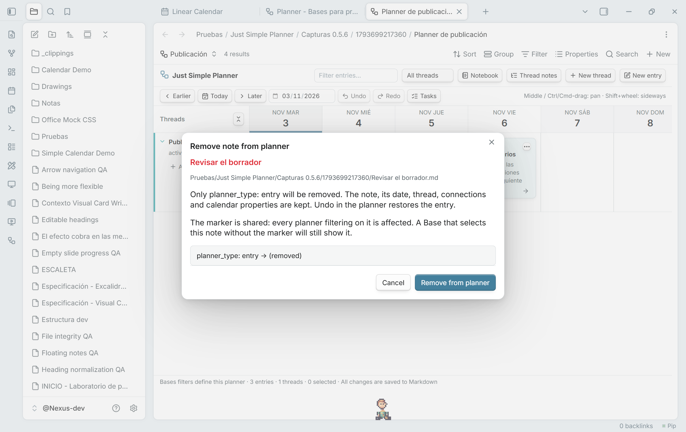
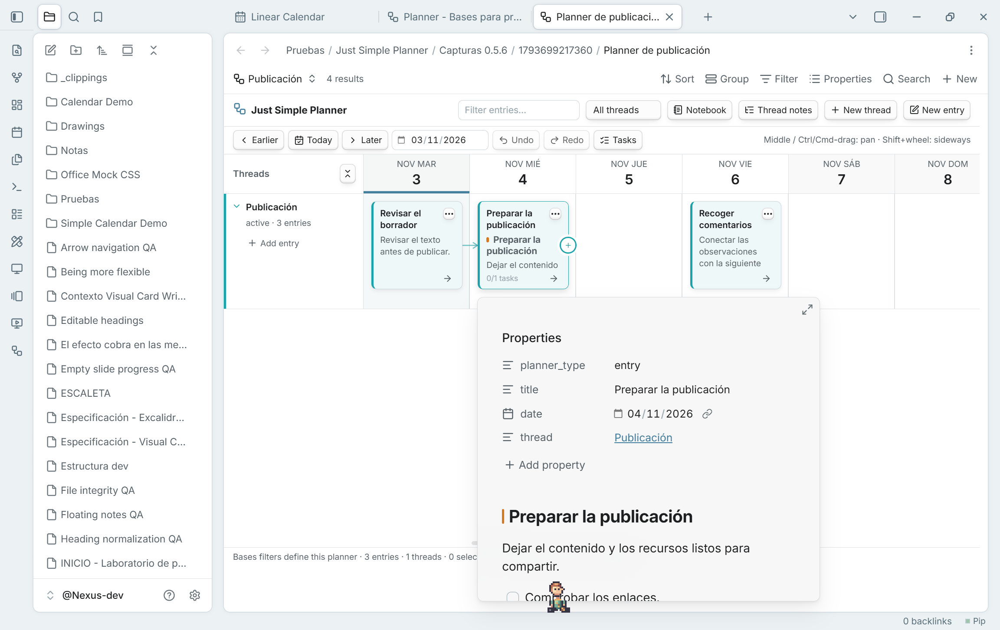

## Remove from planner, keep the note

**Remove note from planner…** is now available from the right-click and three-dot card menus in Bases, as well as the retained classic view. The review removes only **`planner_type: entry`**. Your file, Markdown content, dates, thread, connections and scheduling properties remain. **Undo/Redo** restore or repeat the operation, even after the card leaves the current Base's results.

The usual Base filter is **`planner_type` is `entry` OR `planner_type` is `thread`**, under **All views → Any of the following are true**. Migration creates it automatically. With that filter, removing the entry marker removes the card from the planner. The marker belongs to the shared note, so other planners filtering on it are affected too. A custom Base query can still select the unmarked note; its filters decide membership. Removal is disabled for cards without the entry marker.

## Preview notes on hover

Hover a card to see Obsidian's native note preview, including properties and Markdown content. No click or Ctrl/Cmd is required by default. It works in board and Notebook, classic and Bases, including folded cards and repeated appearances of the same note.

Enable the **Page preview** core plugin. Its **Just Simple Planner** source setting controls whether a modifier key is required. Moving onto card buttons/links closes the card preview and keeps those controls' own actions. Starting a drag, pan or connection also closes the preview. Previews close when their cards are rebuilt, and a preview that finishes loading late cannot cover an active gesture or a closed view.

## Updating and the Bases transition

**Update the same Just Simple Planner plugin to 0.5.6.** GitHub-based installers can detect it as a newer stable version. For a manual update, replace `main.js`, `manifest.json` and `styles.css` with the three assets below and reload the plugin or restart Obsidian. Keep `data.json`, your notes and existing `.base` files. Existing Bases planners do not need another migration.

The **classic view remains deprecated and available; no removal date is set**. The plugin itself is not deprecated. Migration creates a new Base reading the same Markdown notes, without moving or rewriting them. The migration-button, hidden-position and keyboard-priority fixes from 0.5.3–0.5.5 are included.

Validated with 63 unit tests and 177 native checks across 14 suites in the development vault. Original notes/settings are preserved. The validation document records the native popup resize warning separately from unexpected errors and describes platform limits.

[Migration guide](https://github.com/DavidHurtadoAI/just-simple-planner/blob/0.5.6/docs/MIGRATION.md) · [Guía en español](https://github.com/DavidHurtadoAI/just-simple-planner/blob/0.5.6/docs/MIGRACION.es.md) · [Validation](https://github.com/DavidHurtadoAI/just-simple-planner/blob/0.5.6/TESTING.md)
