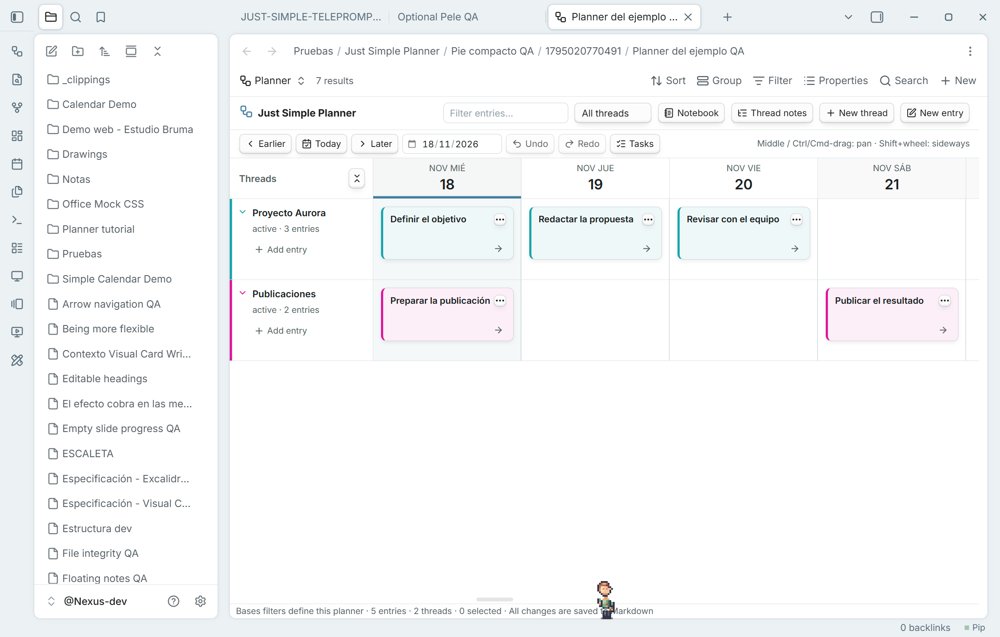

## Planner now runs in Bases

**0.6.0 retires the standalone classic timeline. Enable Obsidian's built-in Bases plugin before using this version.** This remains the same Just Simple Planner plugin ID and the same ordinary Markdown notes.

**Already using Bases?** Update the plugin and reopen your existing `.base` files. No further migration is needed. Your queries, view configuration and source notes remain.

**Still using classic?** The migrator and saved settings remain available:

1. Enable **Bases** in Core plugins, then reload Just Simple Planner.
2. Run **Just Simple Planner: Create Bases planner from classic notes**, or use **Review migration** in the plugin settings or an old restored tab.
3. Review the counts and saved properties, choose a new vault-relative `.base` path and click **Create Base**.
4. Wait for **Migration verified** before changing the initial filters.

Migration creates only the new Base and any missing parent folders. It does not move, rename, duplicate or rewrite your notes, and it does not replace saved settings. It imports the classic property mapping and day width, retains empty thread rows and can import the display state of an old tab. Changed source notes or migration settings require a fresh review.

## Existing access points remain useful

- The ribbon and **Open planner** open Bases, with a chooser when several planner files exist.
- Old workspace tabs show a migration page instead of the retired board.
- Creation and membership commands keep their IDs for existing hotkeys. Actions use the active or explicitly selected Base and its mapping.
- Old parent/child folder settings and unknown saved fields remain supported. Global saved values apply only to migration; configure current planners in their Base.

## A compact footer

The statistics occupy one compact line with a full-text tooltip. The planner no longer reserves the native Bases **60px bottom padding**, returning that height to the timeline. Board and Notebook keep the same compact footer at narrow widths.

## Install or update

Download **`main.js`**, **`manifest.json`** and **`styles.css`** below. Replace those files in the existing plugin folder, retain **`data.json`**, your Markdown notes and existing Bases, then reload the plugin. Requires Obsidian **1.10.2 or later**, with **Bases enabled**.

Validated with **64 unit tests**, official lint, strict TypeScript, production/package checks and **97 desktop in-app checks across seven suites**. The native regression kept all 1,292 pre-existing Markdown files, existing Bases and saved settings unchanged. See the validation document for methods and platform limits. GitHub Actions builds and verifies provenance for the three installable release assets.

[README and upgrade instructions](https://github.com/DavidHurtadoAI/just-simple-planner#bases-planners-and-migration) · [Migration guide](https://github.com/DavidHurtadoAI/just-simple-planner/blob/0.6.0/docs/MIGRATION.md) · [Guía en español](https://github.com/DavidHurtadoAI/just-simple-planner/blob/0.6.0/docs/MIGRACION.es.md) · [Validation](https://github.com/DavidHurtadoAI/just-simple-planner/blob/0.6.0/TESTING.md)
