<div align="center">

# Just Simple Planner

### See the story of your work. Keep it in your notes.

A visual timeline for Obsidian: projects in rows, days in columns, and every card an ordinary Markdown note.

[](https://github.com/DavidHurtadoAI/just-simple-planner/actions/workflows/check.yml)


[](LICENSE)


[Migration guide](docs/MIGRATION.md) · [Guía en español](docs/MIGRACION.es.md) · [Visual tour](#visual-tour) · [Install](#install) · [Settings](#settings) · [Try the examples](#try-the-examples) · [Markdown format](#markdown-format) · [The story and the credit](#the-story-and-the-credit)

</div>

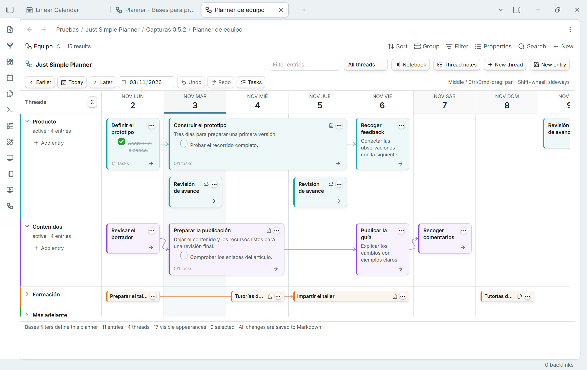

**Your notes, several planners.** Open a Base and choose the **Simple Planner** layout. Each planner uses its own query and view configuration; its cards, threads and arrows remain ordinary Markdown notes and links.

Your work has a past, an unfinished middle, and a next step. Just Simple Planner puts them on one continuous board. Capture a meeting, connect it to a draft, follow a branch into another project, or move the next few steps together when plans change.

**Every card reads an ordinary Markdown note.** Repeated appearances share that same file. You choose where files live. The `thread` property places them on the board; `next` links them together. Your notes remain readable in Obsidian, other editors, and Bases when the plugin is disabled.

Cards with only a title and frontmatter use a shorter height, keeping the two-line title, note menu and continuation arrow. Add Markdown content to return to the normal preview height; blank lines alone do not count as content. Entries on the same day stack using their actual heights.

> **Inspired by [Haftio](https://www.haftio.com/).** The original deserves clear credit. This is an independent Obsidian implementation. Read [the thank-you, the apology, and the story](#the-story-and-the-credit).

## Bases planners and the classic-view transition

**0.5.2 introduces Simple Planner as a native Bases layout.** You can keep several planners in separate Base files or views, select notes with Bases filters, and choose date/title/thread/connections properties per view. Enable Obsidian's built-in Bases plugin; Just Simple Calendar remains independent and is not required.

### Upgrading from 0.4.x: read this first

**The standalone classic view is deprecated, but remains available in this release. No removal date has been set.** The plugin is not deprecated. This is an update to the same plugin ID, with the same Markdown notes; you do not need another plugin or a note-format conversion.

Existing classic tabs, command IDs and settings remain. The ribbon icon opens **Open classic planner**. For a new planner, create/open a Base, add a view and choose **Simple Planner**. To bring an existing classic planner across:

1. Enable Bases, then run **Just Simple Planner: Create Bases planner from classic notes** (also available from the classic banner or **Review migration** in settings).
2. Review the counts, property mapping and classic creation destinations. Choose a **new** vault-relative Base path and click **Create Base**.
3. Wait for **Migration verified** in the new view. The initial comparison checks entry titles/dates, thread membership, connections and thread metadata, retaining empty thread rows.
4. Compare your normal workflow, then tailor the Base filters or add other planners. Select optional scheduling properties explicitly in Configure view.

Migration creates a Base that reads your existing files. It does not move, rename, duplicate or rewrite them, or replace classic settings. Classic creation folders do not become search filters. Notes remain shared: editing a note in one planner changes that same note elsewhere.

Read the **[complete migration guide](docs/MIGRATION.md)** or **[guía en español](docs/MIGRACION.es.md)** for the differences between views, troubleshooting, new-note locations, returning to classic and scheduling limits.

### Several planners, selected by Bases

Selected Markdown notes with a valid date appear without requiring a `planner_type: entry` marker. Thread notes provide row metadata. Same-day cards follow the Base's sorting; dates stay chronological and thread rows retain their status/order. Native Bases grouping does not replace the Thread property. The Base's result limit and filters still apply.

Different views can choose different properties and display settings. Shared filters in the same Base still apply to all its views; use separate Base files for independent root queries. Use **Thread notes** to retain empty rows even outside the query.

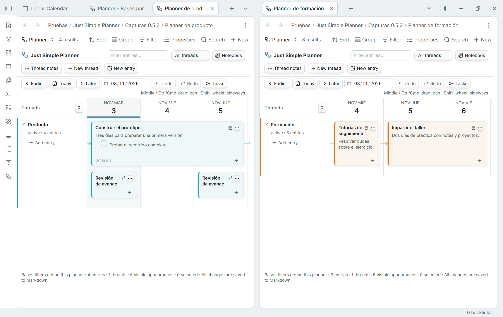

### Multi-day cards and real scheduling

Select **End date property** to extend cards through their inclusive final day. Overlapping ranges stack without covering one another. Dragging an ordinary range preserves both ends, written times/offsets and duration, even when grabbed from its second day. Short title-only cards keep their shorter height.

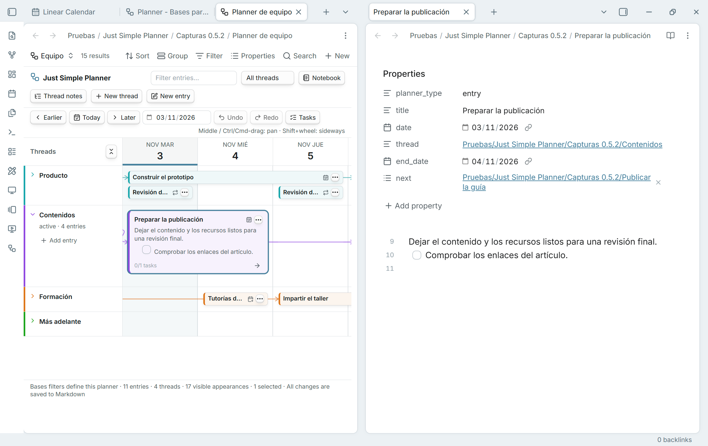

**Optional scheduling** provides repeat, repeat-until, skipped-day and additional-date selectors. For example, a note with `repeat: weekly` appears each week without duplicating the file. The card menu provides date-list editors for configured writable properties. Tasks and connections remain attached to the note once; scheduled appearances do not have separate completion records or graph nodes.

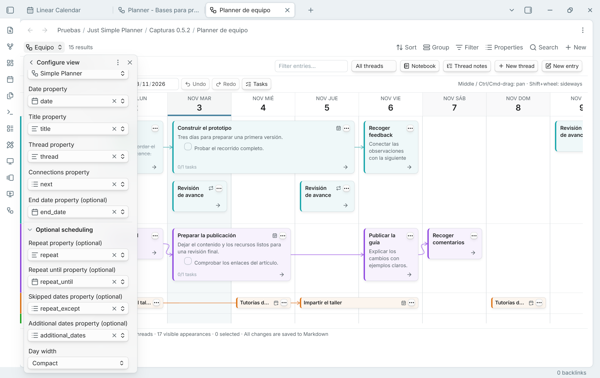

### Notebook, tasks and the same Markdown

Board and Notebook share the existing editor, previews, links, selection, Spotlight and undo/redo. Notebook displays full date ranges; the task rail lists each source note's tasks once. The planner's text filter includes Markdown bodies, while native Bases search searches the displayed properties.

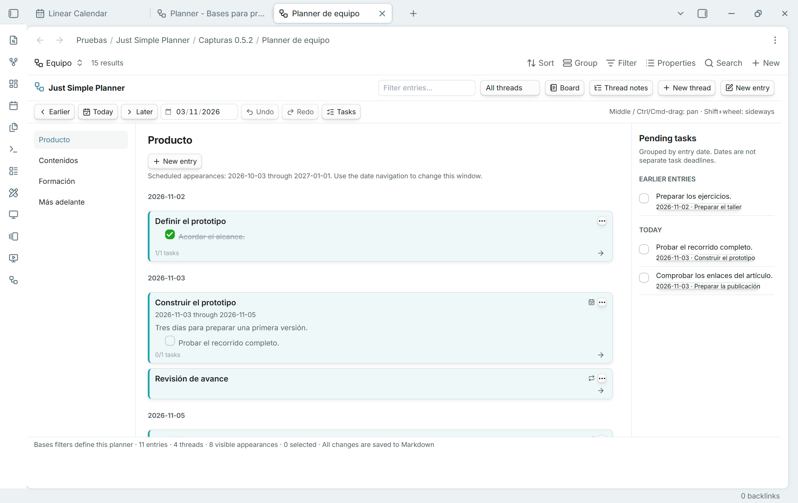

### Creation, scope and careful writes

- Use the planner's **New entry** and **New thread** actions for its editor and connected continuations. These create files through native Bases creation, which chooses the folder/name and applies the Base's creation context. There are no planner-specific creation-folder settings for Bases. A restrictive filter can still exclude a newly created note; the plugin does not override the query. The native Bases **New** action keeps its own normal behavior and may need a date to be filled in.
- New entries retain `planner_type: entry` for classic compatibility. Existing unmarked notes are not marked merely by viewing them. File-explorer membership actions are explicitly labeled **classic**. To exclude notes from a Bases planner, adjust its filters; removing the classic marker need not remove a note selected by other criteria.
- Linked thread notes are resolved directly. **Thread notes** manages explicit empty rows for this view, including notes outside its filters. Removing a row reference never deletes the note. Editing a shared thread's status/order affects that same note wherever it is used.
- An indicator identifies connections outside the current Base results. A whole-flow move is refused until all resolved successors are included. Individual edits stay within the current query; there is no hidden global graph traversal.
- Datetime cards use their written main day. Select **End date property** to extend each card through its inclusive final day. Overlapping date ranges stack without covering one another, retaining the short/full card heights and Base sort. Ongoing notes remain visible if they start before the loaded window; dashed edges mark ranges continuing beyond it. Notebook displays the full date range.
- Moving a range shifts both dates and preserves the written times/offsets and duration. Dragging from a later day keeps that grabbed day under the pointer. A computed date or end date can be displayed but is not writable; invalid end dates show a warning and a one-day card.
- Select **Repeat property** or **Additional dates property** under **Optional scheduling** to show the same note on its scheduled days. Repeat supports `daily`, `weekly`, `monthly`, `yearly`, `every 2 weeks` and compact forms such as `w2`, matching Just Simple Calendar. Optional **Repeat until** includes that last start day; **Skipped dates** omits starts on selected ISO dates. Additional dates are individual `YYYY-MM-DD` values for a single-day note without repetition. Nothing is generated on disk.
- Scheduled appearances share the note's selection, editor, body, tasks and connections. Editing a later appearance edits the original note and main date. Connections remain one relation per note, anchored at its main appearance when loaded, otherwise its first appearance in the window. Tasks are listed once per note. Dragging or moving a flow containing scheduled notes is disabled; edit the original date/rule in the note, and use **Repeat options…** or **Additional dates…** in the card menu for configured writable limits/date lists.
- The board loads a 91-day window; Notebook uses that window for scheduled appearances while retaining ordinary historical entries. Date navigation changes the window. Invalid schedules display warning badges and explanations in the footer tooltip. These scheduling options belong to each Bases view; the classic view keeps its original behavior.
- Each open view has its own history. Concurrent changes from another planner or editor cause a conflict instead of being overwritten. Mapping changes invalidate old editor saves while retaining their drafts. Closing a view releases its session and refuses new stale edits. Creating a note is not undone by deleting it.

Bases supplies discovery and query updates; the new session reads bodies only for its selected Markdown notes and uses small view-scoped caches. The classic global discovery runs when the classic view or a classic/migration action needs it and stops monitoring when no classic view/action remains. Existing global settings below apply to the classic view only.

## Visual tour

The controls below are shared with the classic view. These earlier screenshots illustrate the same card editor, links and task workflow; classic membership/settings are labeled separately below.

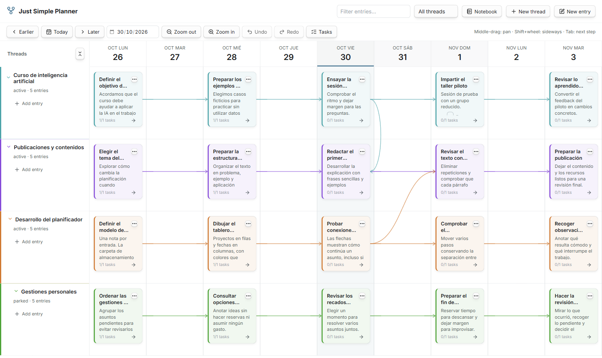

### The three dots: a small menu with the whole workflow

This is the menu you will use to turn individual notes into a connected story:

<p align="center">
  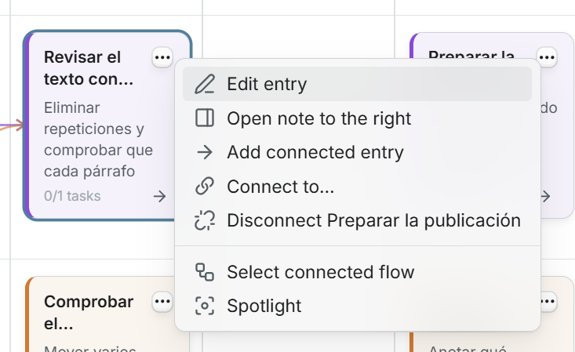
</p>

| Action | What it does |
| --- | --- |
| **Edit entry** | Change the title, date, thread and Markdown body in a focused editor. |
| **Open note to the right** | Open the actual Markdown file beside the board. |
| **Add connected entry** | Start a new entry on the following day, in the same thread, linked from this one. **Tab** does the same when a card is selected. |
| **Connect to…** | Choose an existing entry to continue the story, including one in another thread. |
| **Disconnect…** | Remove a particular outgoing connection. The two notes remain. |
| **Select connected flow** | Select the entry and its connected successors, including branches. Drag them together to preserve the gaps between their dates. |
| **Spotlight** | Highlight this path through the work and dim unrelated entries. |
| **Remove note from planner…** | Review removal of the planner marker while keeping the note, date and calendar properties. Available from 0.4.0. |

### Draw connections with your mouse

Hover a card to reveal the **+ on its right edge**. Drag it onto another card: the arrow follows your pointer and the destination lights up. Release to save the connection as a normal wikilink in `next`.

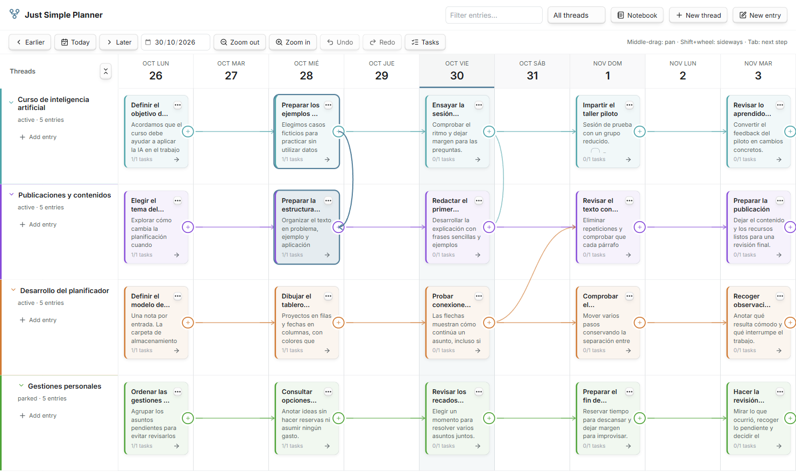

Hover an existing line to reveal **×** and disconnect it directly. The three-dot menu remains available. **Escape** or a drop on empty space cancels the gesture; holding the pointer near the edge scrolls the board. Repeated drops do not create duplicate links. Creation and disconnection both support Undo/Redo.

### Fold a thread without losing its history

A folded thread keeps a row of small, colored cards with **single-line titles** at their dates. Long titles use an ellipsis and can be read in full on hover. Entries on the same day stack rather than cover one another.

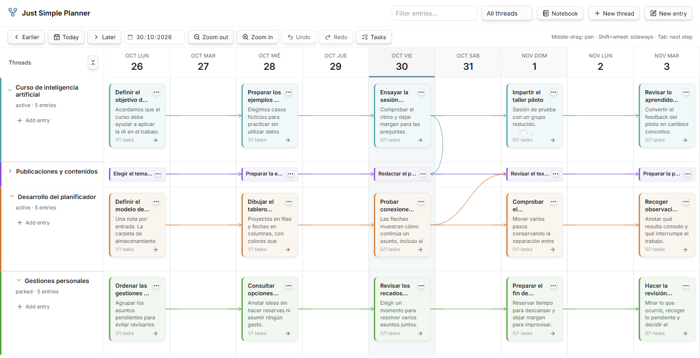

The compact cards keep their note menu, selection, dragging and connection handles. Expand the thread to return to full Markdown previews. Folding is a view choice; `active`, `parked` and `closed` are separate thread statuses.

### Follow one path with Spotlight

A busy board can hold many parallel stories. Spotlight keeps the selected entry, its ancestors and its following branches visible while dimming unrelated work.

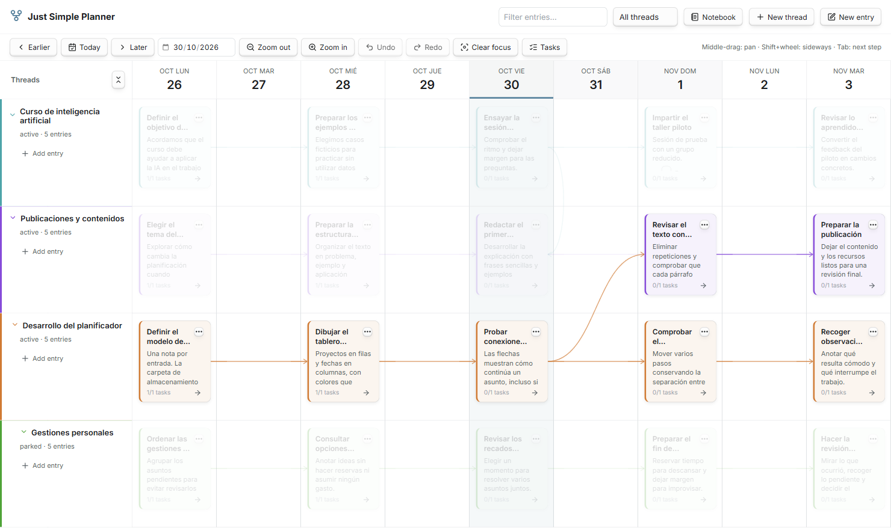

Press **Escape** or **Clear focus** to return to the full board.

### Read a thread as a notebook. Gather its tasks.

Switch to **Notebook** to read one thread in date order. The same notes become a vertical journal. The **Tasks** rail collects pending Markdown checkboxes from the current filters; completing one updates the source file.

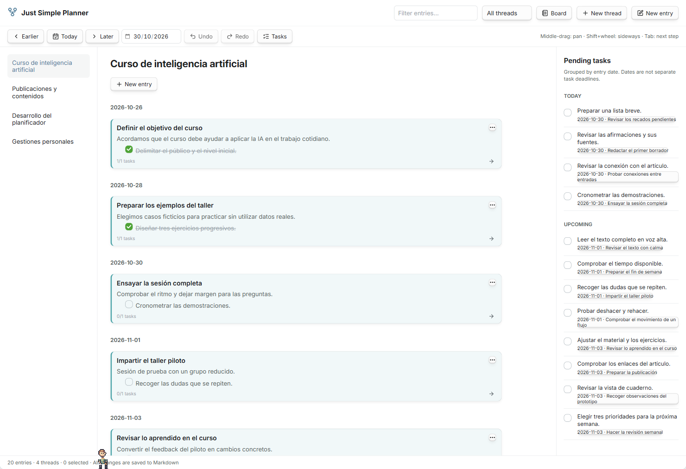

Tasks are grouped by the date of their entry. That date is not an independent deadline for each checkbox. Fenced-code examples are ignored when gathering tasks.

### Write in Markdown

Double-click a card, or select it and press **Enter / F2**, to edit. The editor changes the normal note file; the body supports Markdown, links, attachments and checkbox tasks.

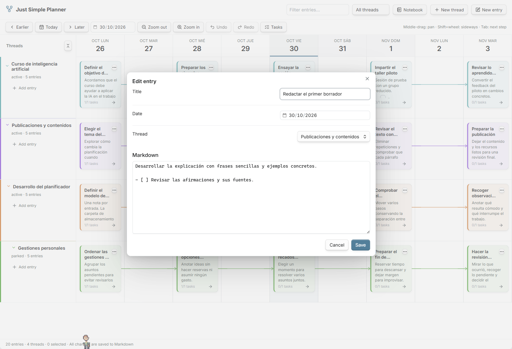

The interface and property names are English. Notes, filenames and thread names can use your language. All notes shown here are fictional Spanish examples, captured in the actual Obsidian plugin.

## Mouse and keyboard

| Gesture | Action |
| --- | --- |
| Left-drag a card | Reschedule it; drag a single card into another thread to change its membership. |
| Middle-button drag | Pan: the content follows your hand, matching Visual Card Writer. |
| Ctrl/Cmd + left-button drag | Pan the board from empty space or a card. A small movement threshold keeps Ctrl/Cmd-click available for selection. Buttons and links keep their normal actions. |
| Mouse wheel / Shift + wheel | Scroll vertically / horizontally. |
| Ctrl/Cmd-click | Add or remove a card from the selection. |
| Shift-drag a card | Include its connected successors in the move. |
| Ctrl/Cmd + left/right | Move the selected entries by one day. |
| Tab on a selected card | Create the following day's connected entry. |
| Enter / F2 | Edit the selected entry. |
| Ctrl/Cmd-Z / Ctrl/Cmd-Shift-Z | Undo / redo while the board has focus. Ctrl/Cmd-Y also redoes. |
| Escape | Cancel a connection, or clear selection and Spotlight. |

The board extends into the past and future as you scroll, rendering a bounded 91-day window. Use **Today**, the date picker and **Earlier / Later** to navigate. Choose the column width in plugin settings under **Day width**. Filter by text and thread status; right-click a thread label to change its status or order.

## Install

Download the installable files from the **[latest GitHub release](https://github.com/DavidHurtadoAI/just-simple-planner/releases/latest)**. The plugin requires **Obsidian 1.10.2 or later**.

1. Download **`main.js`**, **`manifest.json`** and **`styles.css`** from the release's Assets section.
2. Create a `just-simple-planner` folder under your vault's configuration directory, normally `.obsidian/plugins/`.
3. Put the three files directly inside that folder, reload Obsidian and enable **Just Simple Planner** in Community plugins.
4. Enable **Bases** in Core plugins. If it was previously disabled, reload Just Simple Planner. Create or open a Base, add a view and choose **Simple Planner**.
5. Set the Base filters and view properties, then use **New thread** and **New entry** inside the planner. Existing users can run **Create Bases planner from classic notes** instead; follow the [migration guide](docs/MIGRATION.md).

**Updating an existing installation:** replace the three release files and keep your notes and plugin data. Both the deprecated classic view and the Bases layout are included.

From **0.1.2**, release files are built, checked and published by GitHub Actions with cryptographic build-provenance attestations. After downloading the three files, verify each with GitHub CLI:

```sh
gh attestation verify main.js --repo DavidHurtadoAI/just-simple-planner
gh attestation verify manifest.json --repo DavidHurtadoAI/just-simple-planner
gh attestation verify styles.css --repo DavidHurtadoAI/just-simple-planner
```

## Settings

**The global controls below apply to the deprecated classic view.** Bases planners choose properties and day width in **Configure view** and use native Bases creation, with no planner-specific folder settings.

Classic settings use English labels and defaults and save automatically. **Dropdowns save immediately. Text fields save when you press Enter or leave the field, including when you close settings.** Each field shows save feedback or a validation error. Invalid changes leave the last valid configuration active; a dropdown that cannot be saved returns to its active value. Folder settings from older versions are adapted as described below; zoom and property mapping are retained.

### Storage folders: notes can live anywhere

| Setting | Default | Meaning |
| --- | --- | --- |
| **Threads folder** | `Planner/Threads` | Vault-relative destination for new thread notes. Thread notes hold each row's color, status and order. |
| **New entries folder** | `Planner/Entries` | Vault-relative destination for notes created with **New entry**. Existing notes added to the planner keep their original location. |

These are storage locations, **not search filters**. Leave either path empty to create that kind of note in the vault root. Missing folders are created when the first new note is saved; absolute paths, parent traversal and paths through files are rejected.

A card can be `Clientes/Acme/Reunión.md` while its thread note lives in `Planner/Threads/Acme.md`. Moving the entry or changing a creation folder never changes its membership. Marked threads are also retained if moved elsewhere in the vault.

### Only notes you include become entries

Cards require **`planner_type: entry`** and a valid **`YYYY-MM-DD`** date in the configured **Date property**, wherever the note lives. Rows use **`planner_type: thread`**, including empty threads. A date alone never adds a note; **Show all dated notes remains removed**.

The `thread` property determines the row. Missing thread values appear under **Unassigned**. The configured title property takes precedence; an empty or missing title uses the complete filename without `.md`, including any date prefix. There is no duplicate copy and no separate membership list hidden in plugin settings.

### Add an existing note — keep its calendar date or review a new one

Right-click one Markdown note in Obsidian's file explorer and choose **Add note to classic planner…**. The review shows its current path, date and thread, and the exact properties that will change. Existing titles, connections, calendar properties and Markdown content are kept. **Cancel writes nothing.**

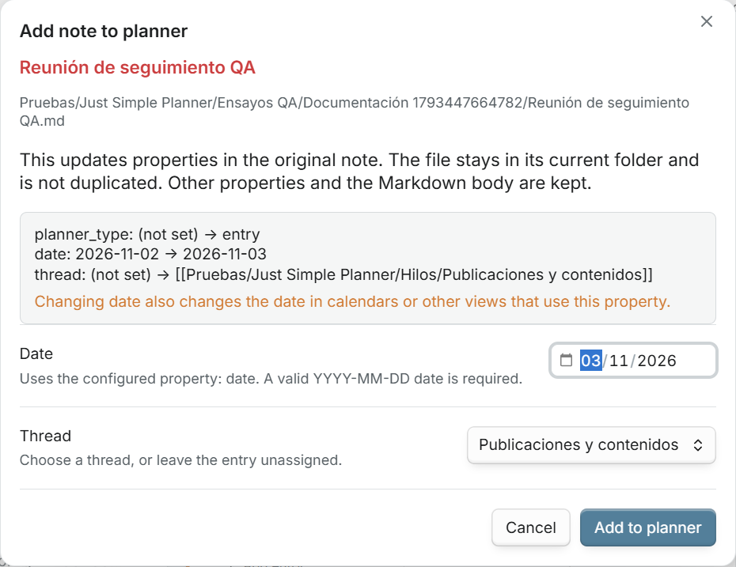

You can also drag one note from the file explorer:

| Drop destination | Proposed result |
| --- | --- |
| A thread header on the board | Select that thread and keep the note's valid existing date. |
| A day cell on the board | Select that thread and propose the day you dropped onto. |
| A thread or its content in Notebook | Select that thread and keep the existing date. |
| An empty planner | Review a date and thread, with Unassigned available. |

Every external-note drop opens the same review before saving. Hover feedback explains the destination and that the file stays in place. One note at a time is supported; folders, files from other vaults and external filesystem imports are rejected. Dropping an already included note updates the same entry instead of creating another card.

**Calendar dates are shared.** If the note already has a valid date under the configured key, it is reused. Choosing a different date updates that property in the original note, which can also move the note in a calendar or another view using the same key. The review highlights the old and new values and warns before saving. A datetime is not accepted as a planner day: choose a property containing `YYYY-MM-DD`.

Dragging a card that is already on the board still reschedules it directly, as before. Dragging a file from the explorer always opens a review.

### Remove from planner — keep the note and its calendar entry

Use **Remove note from classic planner…** in the file explorer, or **Remove note from planner…** in a classic card's menu. The review removes **only `planner_type: entry`**. The file, date, title, thread, connections, calendar properties and note body are retained. Existing wikilinks are kept; an excluded note's arrows are not drawn. **Undo / Redo** also cover adding and removing existing notes.

The command palette also provides **Add active note to classic planner** and **Remove active note from classic planner**. An included note's file menu offers **Show in classic planner**, which clears filters and reveals its card.

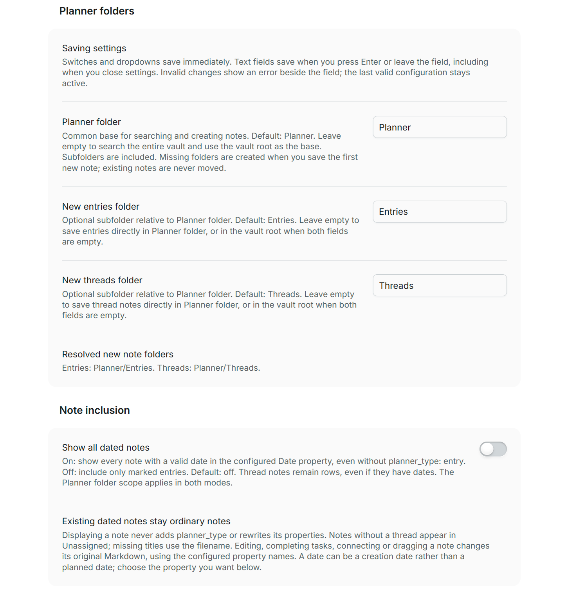

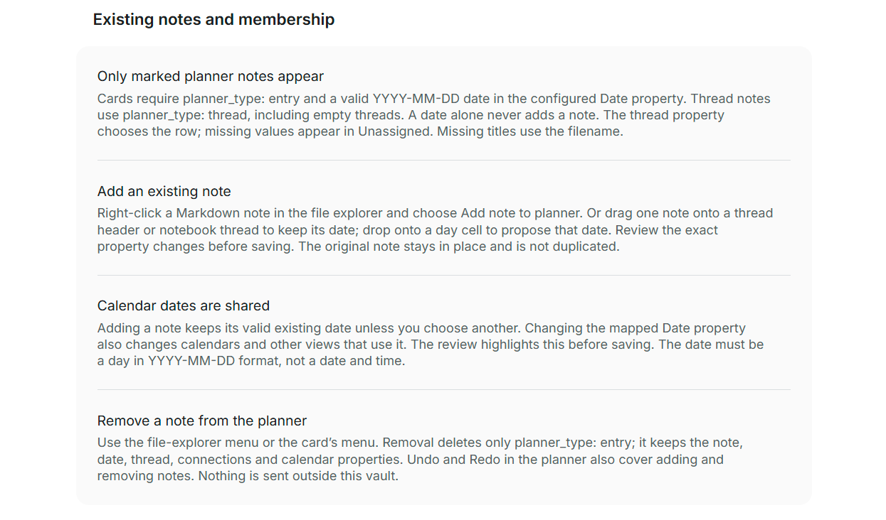

### Property mapping: use your existing frontmatter names

| Setting | Default key | Value |
| --- | --- | --- |
| **Date property** | `date` | Calendar date in `YYYY-MM-DD` format. Required for a card to appear. |
| **Title property** | `title` | Card title. An empty or missing value uses the filename. |
| **Thread property** | `thread` | A wikilink to a thread note, or a plain-text group name. |
| **Connections property** | `next` | A YAML list of wikilinks to following entries. |

For example, select `scheduled`, `headline`, `project` and `following` if those are the keys you already use. The mapping applies to reading, creating, editing, moving and connecting entries, including task edits. Keys must be non-empty and different; `planner_type` stays fixed and is reserved. Thread notes keep `status`, `color` and `order`.

**Changing the mapping does not migrate notes.** Existing properties are not renamed or rewritten. Marked entries without a valid mapped date are counted as invalid and excluded. Missing title values use the filename; missing thread values are unassigned; missing connections produce no arrows. Restore the previous mapping to read the previous schema again, or deliberately update your notes yourself. Changes to property mapping clear session undo/redo so old actions cannot modify notes under a different configuration.

**Day width** chooses the default zoom. Changes to creation folders or day width keep the current note schema and undo history.

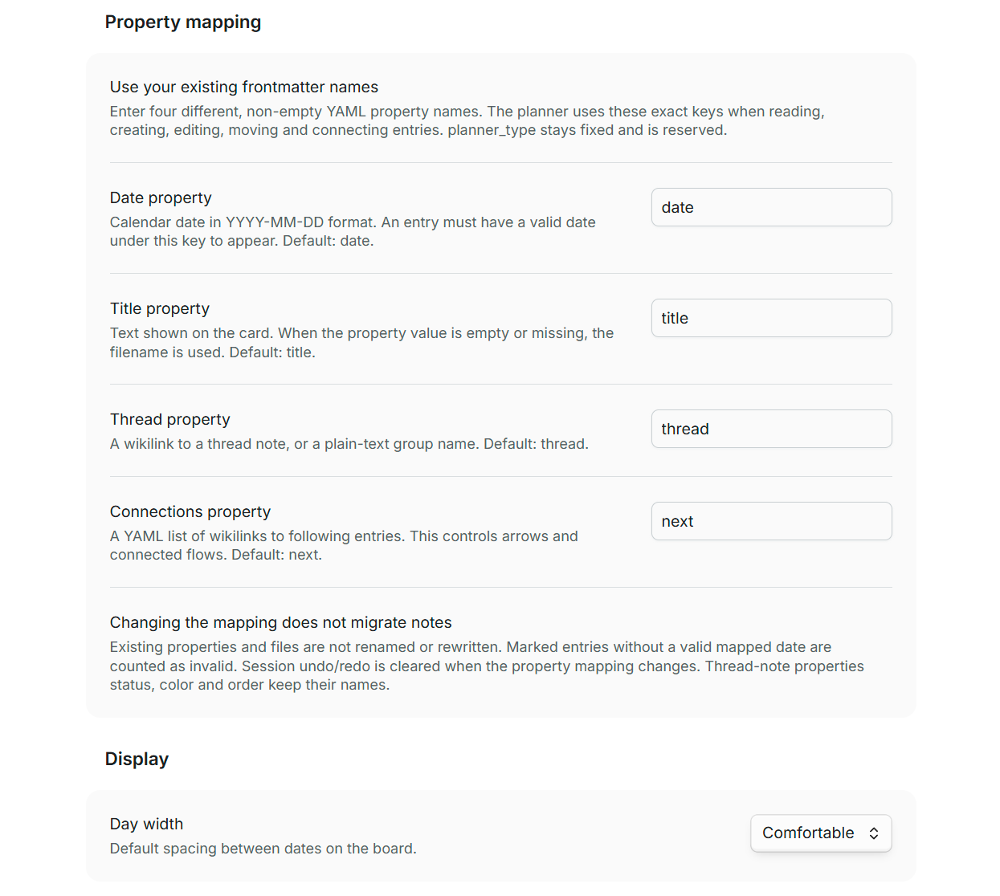

### Updating from 0.3.x and older versions

**Planner folder has been removed as a search scope.** On update, its old base is combined with each relative child path to preserve the full creation destinations. For example, base `Cursos/IA`, entries `Entradas` and threads `Hilos` become `Cursos/IA/Entradas` and `Cursos/IA/Hilos`. Empty children keep the old base; an empty base keeps the old vault-relative child. Older configurations that already stored full paths retain them.

No files are moved or rewritten by this migration. Folder paths, property mappings and day width are retained. **Previously marked entries and threads outside the old search folder now appear too. Unmarked dated notes remain excluded.** The obsolete dated-note flag is ignored.

## Try the examples

Copy the contents of [`examples/`](examples) into any folder in your vault, preserving the `Entradas` and `Hilos` subfolders. Open the planner and navigate to **30 October 2026**.

You get **20 entries, four threads, 18 connections and 12 pending tasks** covering a course, publications, plugin development and personal errands. Their wikilinks use note names, so the containing folder can have any name. All sample content is fictional.

## Markdown format

An entry is a file like `2026-10-30 - Revisar la propuesta.md`:

```markdown
---
planner_type: entry
title: Revisar la propuesta
date: 2026-10-30
thread: "[[Proyecto Aurora]]"
next:
  - "[[Enviar el borrador]]"
---
Revisamos el planteamiento con el equipo.

- [ ] Preparar el borrador
```

| Entry property | Meaning |
| --- | --- |
| `planner_type: entry` | Opt this note into the planner. Other notes are never turned into cards automatically. |
| `title` | Card title; falls back to the filename. Editing it does not rename the file. |
| `date` | Calendar day in `YYYY-MM-DD` format. Bases also accepts datetimes and uses their written day. |
| `thread` | Wikilink to the thread note. A plain-text group is also accepted. |
| `next` | A list of wikilinks to following entries. Connections are optional and can branch. |

A thread is another ordinary note:

```yaml
---
planner_type: thread
status: active
color: cyan
order: 0
---
```

Its filename is the thread title. `status` accepts `active`, `parked` or `closed`; active threads appear first. `color` accepts Obsidian's eight palette names or a quoted six-digit hex value. `order` controls the order within a status. Thread notes allow empty threads to exist before their first entry.

Moving an entry to another folder does not change its thread. Use Obsidian's normal move/rename commands and link-update behavior when relocating notes. Unresolved thread links appear under **Unassigned**. Unresolved `next` links remain in the source but cannot be drawn. Invalid dates or frontmatter are counted in the footer.

## Local data and careful writes

The plugin has **zero runtime package dependencies** and makes no network requests of its own. It has no account, telemetry, analytics or remote database. Bodies, dates, thread membership and connections live in Markdown. Classic settings hold its property names, creation folders and day width. Each Base view stores its own configuration; Obsidian's workspace holds the open layout.

**Bases discovery:** the Base supplies the query results. Each view reads selected Markdown bodies and directly linked/explicit thread notes, with its own small cache and history. It does not start the classic global index.

**Classic discovery:** when requested by a classic view or action, the plugin makes one initial pass over Markdown paths and cached frontmatter throughout this vault to find explicit entry/thread markers. The cache check yields periodically to keep the UI responsive. Only marked notes have their bodies read. Subsequent metadata events discover newly included notes without another whole-vault enumeration; link resolution uses existing in-memory snapshots. Manual refreshes revisit known paths. Unrelated notes are not parsed or opened on edit/rename. The community scanner can report **Vault Enumeration**, which is intentional for scattered, explicitly included notes. Nothing is uploaded or shared.

Writes compare the note with its snapshot before saving. A concurrent edit causes a conflict instead of being silently overwritten. Multi-note operations try to roll back earlier writes if a later write fails; a rollback conflict is reported for review. This is optimistic conflict protection, not a filesystem-wide transaction.

Undo history is in memory, capped at 40 operations and cleared on plugin reload or when property mapping changes. It covers enrollment, removal, edits, moves, connections and task completion. **Creating a note is not undone by deleting it**; the plugin never deletes your notes. YAML values and Markdown content are retained, although YAML formatting and comments may be normalized when properties are edited.

## The story and the credit

This started with [Haftio](https://www.haftio.com/), a visual planner I discovered through a Reddit post by [u/lalatfe](https://www.reddit.com/user/lalatfe/), whose post is shown in [my account of the experiment](https://davidhurtado.ai/Posts/2026.10/30-extra%C3%B1o-mundo).

**To Haftio's creator and team: thank you — and sorry for borrowing such a good idea so quickly.** I liked what you had built, asked **Máquina**, my AI assistant to explore it, and came back from breakfast to a working Obsidian prototype. The speed of that experiment does not diminish the thought, design and work behind the original.

Haftio deserves clear credit for the inspiration: the continuous timeline, threads and connected entries. This repository contains an independent implementation for local Markdown notes inside Obsidian. There is no affiliation or endorsement implied.

Please **[try Haftio](https://app.haftio.com/)**, explore its **[guide](https://www.haftio.com/guides)**, read **[how it began on a physical whiteboard](https://www.haftio.com/about)**, and support its makers. The credit belongs near the product, not hidden in a footnote.

I wrote about the excitement and the discomfort of this in **[He copiado una app mientras desayunaba](https://davidhurtado.ai/Posts/2026.10/30-extra%C3%B1o-mundo)**, published on 30 October 2026.

## Development and current scope

```sh
git clone https://github.com/DavidHurtadoAI/just-simple-planner.git
cd just-simple-planner
npm ci
npm run check
```

Use **Node.js 24** for the documented build. The check runs the official Obsidian ESLint rules with zero warnings, strict TypeScript validation, unit tests, the production build and a package audit. GitHub Actions runs the same command. The documented in-app checks include connection dragging, hover controls, cancellation, undo, task completion and the independence of file location from thread membership. See [`TESTING.md`](TESTING.md) for the exact methods and limits, and the [Obsidian review notes](docs/OBSIDIAN_REVIEW.md) for the release audit.

Publishing a version tag triggers [the release workflow](.github/workflows/release.yml). It builds and checks the source, attests all three installable files, verifies their attestations, and uploads those exact bytes to GitHub Releases. Release tags must exactly match `manifest.json` and have a matching notes file in `.github/release-notes/`. The workflow's actions are pinned by commit SHA; permissions for publishing and signing are limited to the release job.

The scripts that drive Obsidian's CLI are maintainer tools for the dedicated `@Nexus-dev` development vault. They guard its exact path. The public examples above can be used in your own vault without running those scripts.

This version focuses on local planning. It does not connect external calendars, send background reminders, provide real-time collaboration, implement recurring entries or parse Tasks-plugin deadline syntax. Physical phones/tablets, touch dragging, very large vaults and simultaneous multi-device editing have not been validated.

Found a bug or have a useful workflow to suggest? [Open an issue](https://github.com/DavidHurtadoAI/just-simple-planner/issues). Include your Obsidian version, the gesture you tried, and what you expected to happen.

## License

[MIT](LICENSE). Copyright 2026 David Hurtado. An independent community plugin for Obsidian.
