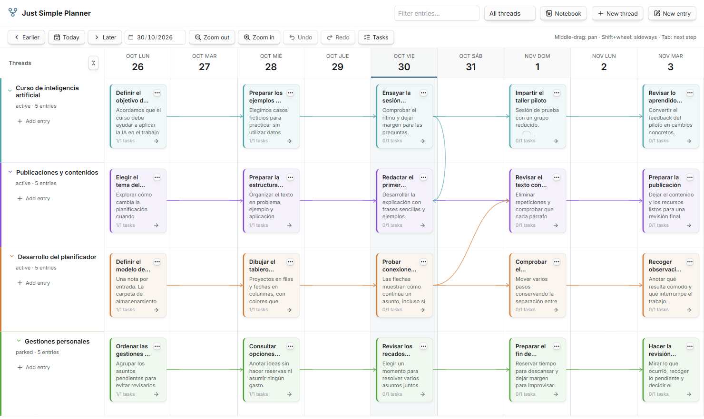
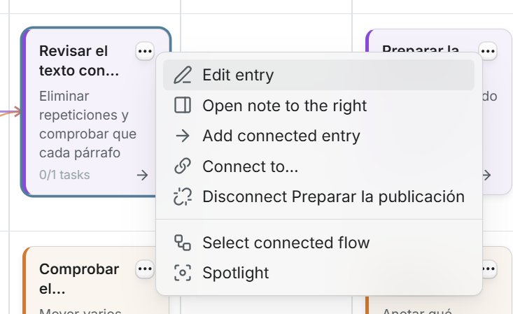
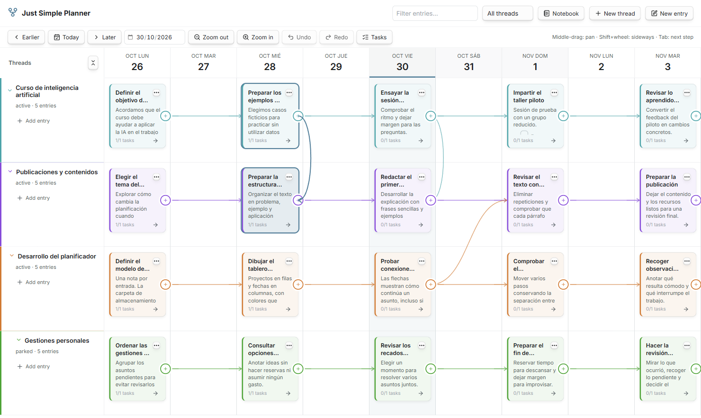
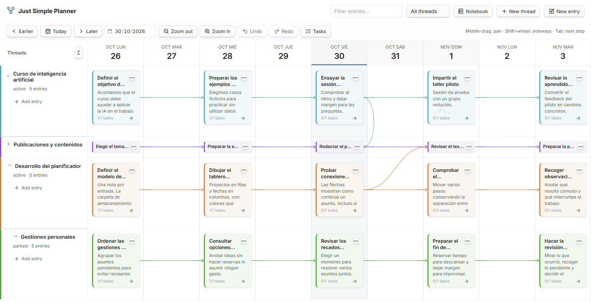
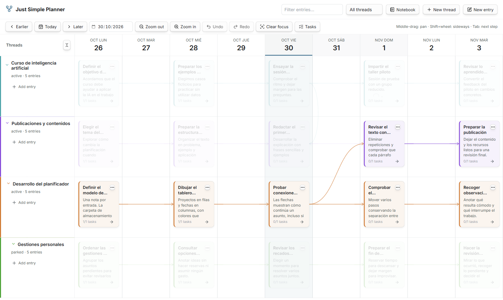
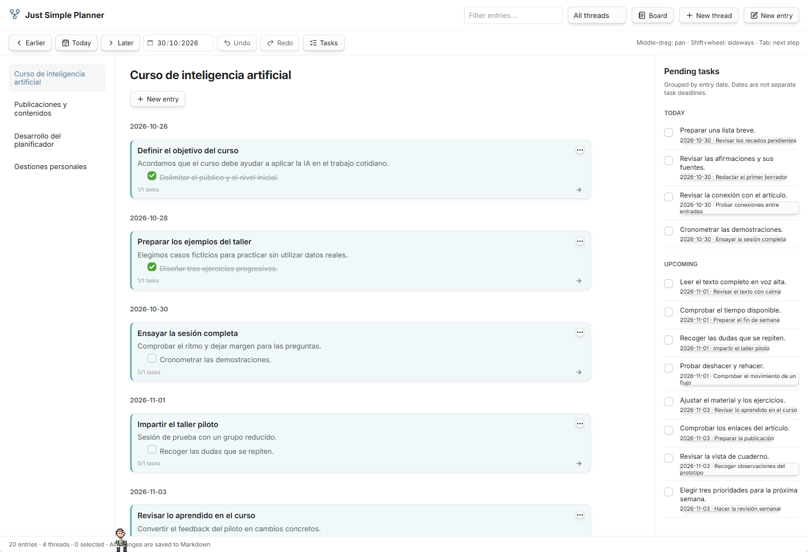
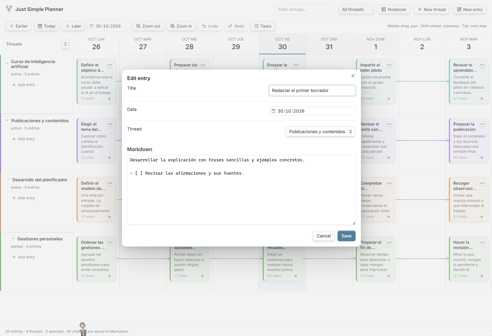
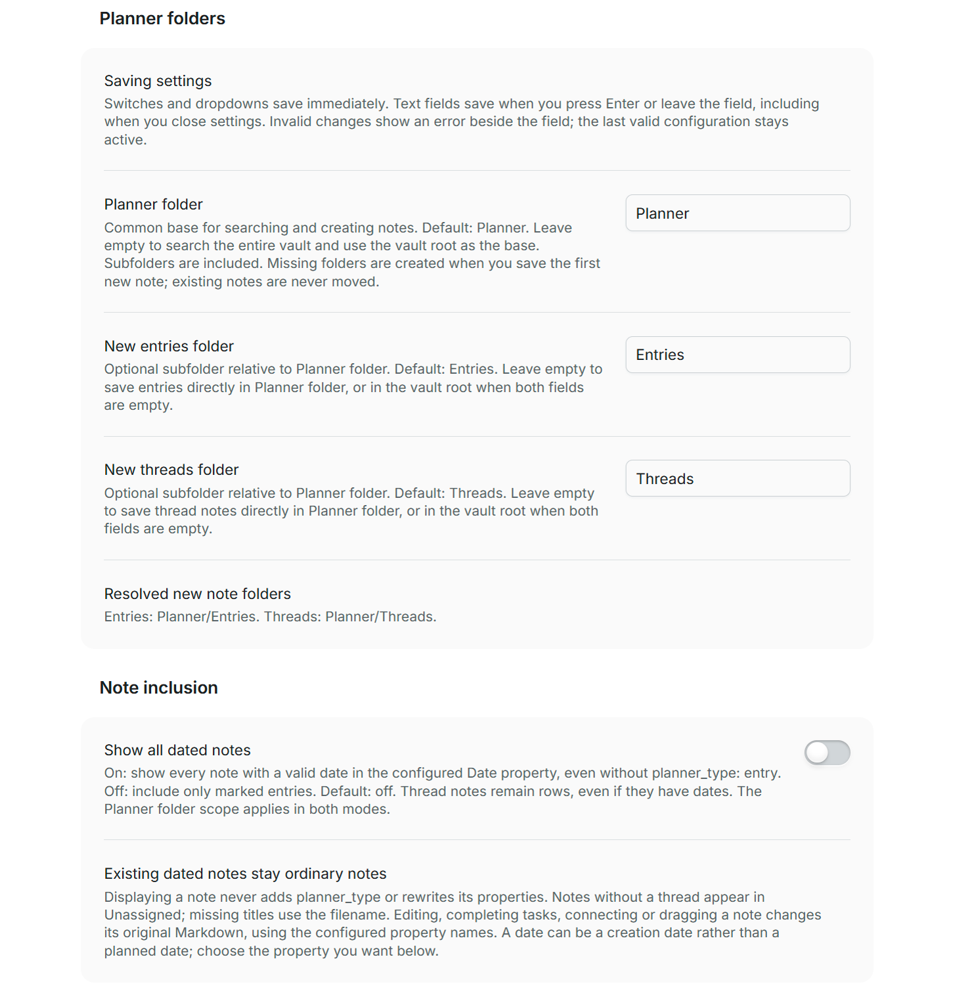
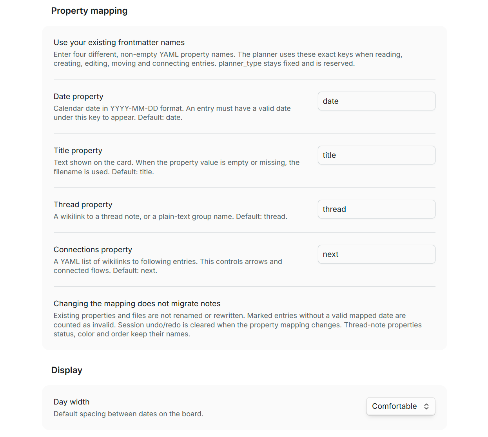

<div align="center">

# Just Simple Planner

### See the story of your work. Keep it in your notes.

A visual timeline for Obsidian: projects in rows, days in columns, and every card an ordinary Markdown note.

[](https://github.com/DavidHurtadoAI/just-simple-planner/actions/workflows/check.yml)


[](LICENSE)


[Visual tour](#visual-tour) · [Install](#install) · [Settings](#settings) · [Try the examples](#try-the-examples) · [Markdown format](#markdown-format) · [The story and the credit](#the-story-and-the-credit)

</div>



Your work has a past, an unfinished middle, and a next step. Just Simple Planner puts them on one continuous board. Capture a meeting, connect it to a draft, follow a branch into another project, or move the next few steps together when plans change.

**One card = one Markdown note.** You choose where files live. The `thread` property places them on the board; `next` links them together. Your notes remain readable in Obsidian, other editors, and Bases when the plugin is disabled.

> **Inspired by [Haftio](https://www.haftio.com/).** The original deserves clear credit. This is an independent Obsidian implementation. Read [the thank-you, the apology, and the story](#the-story-and-the-credit).

## Visual tour

### The three dots: a small menu with the whole workflow

This is the menu you will use to turn individual notes into a connected story:

<p align="center">
  
</p>

| Action | What it does |
| --- | --- |
| **Edit entry** | Change the title, date, thread and Markdown body in a focused editor. |
| **Open note to the right** | Open the actual Markdown file beside the board. |
| **Add connected entry** | Start a new entry on the following day, in the same thread, linked from this one. **Tab** does the same when a card is selected. |
| **Connect to…** | Choose an existing entry to continue the story, including one in another thread. |
| **Disconnect…** | Remove a particular outgoing connection. The two notes remain. |
| **Select connected flow** | Select the entry and its connected successors, including branches. Drag them together to preserve the gaps between their dates. |
| **Spotlight** | Highlight this path through the work and dim unrelated entries. |

### Draw connections with your mouse

Hover a card to reveal the **+ on its right edge**. Drag it onto another card: the arrow follows your pointer and the destination lights up. Release to save the connection as a normal wikilink in `next`.



Hover an existing line to reveal **×** and disconnect it directly. The three-dot menu remains available. **Escape** or a drop on empty space cancels the gesture; holding the pointer near the edge scrolls the board. Repeated drops do not create duplicate links. Creation and disconnection both support Undo/Redo.

### Fold a thread without losing its history

A folded thread keeps a row of small, colored cards with **single-line titles** at their dates. Long titles use an ellipsis and can be read in full on hover. Entries on the same day stack rather than cover one another.



The compact cards keep their note menu, selection, dragging and connection handles. Expand the thread to return to full Markdown previews. Folding is a view choice; `active`, `parked` and `closed` are separate thread statuses.

### Follow one path with Spotlight

A busy board can hold many parallel stories. Spotlight keeps the selected entry, its ancestors and its following branches visible while dimming unrelated work.



Press **Escape** or **Clear focus** to return to the full board.

### Read a thread as a notebook. Gather its tasks.

Switch to **Notebook** to read one thread in date order. The same notes become a vertical journal. The **Tasks** rail collects pending Markdown checkboxes from the current filters; completing one updates the source file.



Tasks are grouped by the date of their entry. That date is not an independent deadline for each checkbox. Fenced-code examples are ignored when gathering tasks.

### Write in Markdown

Double-click a card, or select it and press **Enter / F2**, to edit. The editor changes the normal note file; the body supports Markdown, links, attachments and checkbox tasks.



The interface and property names are English. Notes, filenames and thread names can use your language. All notes shown here are fictional Spanish examples, captured in the actual Obsidian plugin.

## Mouse and keyboard

| Gesture | Action |
| --- | --- |
| Left-drag a card | Reschedule it; drag a single card into another thread to change its membership. |
| Middle-button drag | Pan: the content follows your hand, matching Visual Card Writer. |
| Ctrl/Cmd + left-button drag | Pan the board from empty space or a card. A small movement threshold keeps Ctrl/Cmd-click available for selection. Buttons and links keep their normal actions. |
| Mouse wheel / Shift + wheel | Scroll vertically / horizontally. |
| Ctrl/Cmd-click | Add or remove a card from the selection. |
| Shift-drag a card | Include its connected successors in the move. |
| Ctrl/Cmd + left/right | Move the selected entries by one day. |
| Tab on a selected card | Create the following day's connected entry. |
| Enter / F2 | Edit the selected entry. |
| Ctrl/Cmd-Z / Ctrl/Cmd-Shift-Z | Undo / redo while the board has focus. Ctrl/Cmd-Y also redoes. |
| Escape | Cancel a connection, or clear selection and Spotlight. |

The board extends into the past and future as you scroll, rendering a bounded 91-day window. Use **Today**, the date picker, **Earlier / Later**, and three zoom levels to navigate. Filter by text and thread status; right-click a thread label to change its status or order.

## Install

Download the installable files from the **[latest GitHub release](https://github.com/DavidHurtadoAI/just-simple-planner/releases/latest)**. The plugin requires **Obsidian 1.10.2 or later**.

1. Download **`main.js`**, **`manifest.json`** and **`styles.css`** from the release's Assets section.
2. Create a `just-simple-planner` folder under your vault's configuration directory, normally `.obsidian/plugins/`.
3. Put the three files directly inside that folder, reload Obsidian and enable **Just Simple Planner** in Community plugins.
4. Run **Just Simple Planner: Open planner** from the command palette, or click the workflow icon (two connected squares) in the ribbon.
5. Create a **New thread**, then a **New entry**. Double-click an empty day cell to start an entry at that date and thread.

The first public release is **0.1.0**. Community directory submission and review are pending; manual installation is available now.

From **0.1.2**, release files are built, checked and published by GitHub Actions with cryptographic build-provenance attestations. After downloading the three files, verify each with GitHub CLI:

```sh
gh attestation verify main.js --repo DavidHurtadoAI/just-simple-planner
gh attestation verify manifest.json --repo DavidHurtadoAI/just-simple-planner
gh attestation verify styles.css --repo DavidHurtadoAI/just-simple-planner
```

## Settings

Settings use English labels and defaults. Edit the fields, then select **Apply settings** to validate and save them together. Existing saved creation folders and zoom are preserved on update; the default property names and whole-vault search keep existing planner notes compatible.

### Search scope: what appears on the board

**Search entire vault** is on by default. Turn it off to reveal **Search folder**, where you must enter an existing vault-relative folder. Its subfolders are included. This applies to both entries and thread notes; links to notes outside that scope do not add those notes to the board.

Only notes marked **`planner_type: entry`** or **`planner_type: thread`** are included. Enabling whole-vault search never turns every note into a card.

### New note locations: where files are saved

| Setting | Default | Meaning |
| --- | --- | --- |
| **New entries folder** | `Planner/Entries` | Folder for new entry notes. Empty means the vault root. |
| **New threads folder** | `Planner/Threads` | Folder for new thread notes. Empty means the vault root. |

These paths do not filter existing notes, decide thread membership, or move files. You can store notes anywhere while keeping their thread through a property. If you create a note outside the selected search folder, it is saved and a notice explains why it is hidden. A connected continuation still saves its link. Change the search scope to display it.



### Property mapping: use your existing frontmatter names

| Setting | Default key | Value |
| --- | --- | --- |
| **Date property** | `date` | Calendar date in `YYYY-MM-DD` format. Required for a card to appear. |
| **Title property** | `title` | Card title. An empty or missing value uses the filename. |
| **Thread property** | `thread` | A wikilink to a thread note, or a plain-text group name. |
| **Connections property** | `next` | A YAML list of wikilinks to following entries. |

For example, select `scheduled`, `headline`, `project` and `following` if those are the keys you already use. The mapping applies to reading, creating, editing, moving and connecting entries, including task edits. Keys must be non-empty and different; `planner_type` stays fixed and is reserved. Thread notes keep `status`, `color` and `order`.

**Changing the mapping does not migrate notes.** Existing properties are not renamed or rewritten. A note without a valid date under the selected key is counted as invalid and excluded from the board. Missing title values use the filename; missing thread values are unassigned; missing connections produce no arrows. Restore the previous mapping to read the previous schema again, or deliberately update your notes yourself. Scope and mapping changes clear session undo/redo so old actions cannot modify notes under a different configuration.

**Day width** chooses the default zoom. Changes to creation folders or zoom keep the current note schema and undo history.



## Try the examples

Copy the contents of [`examples/`](examples) into a folder in your vault, preserving the `Entradas` and `Hilos` subfolders. Open the planner and navigate to **30 October 2026**.

You get **20 entries, four threads, 18 connections and 12 pending tasks** covering a course, publications, plugin development and personal errands. Their wikilinks use note names, so the containing folder can have any name. All sample content is fictional.

## Markdown format

An entry is a file like `2026-10-30 - Revisar la propuesta.md`:

```markdown
---
planner_type: entry
title: Revisar la propuesta
date: 2026-10-30
thread: "[[Proyecto Aurora]]"
next:
  - "[[Enviar el borrador]]"
---
Revisamos el planteamiento con el equipo.

- [ ] Preparar el borrador
```

| Entry property | Meaning |
| --- | --- |
| `planner_type: entry` | Opt this note into the planner. Other notes are never turned into cards automatically. |
| `title` | Card title; falls back to the filename. Editing it does not rename the file. |
| `date` | Calendar day in `YYYY-MM-DD` format. |
| `thread` | Wikilink to the thread note. A plain-text group is also accepted. |
| `next` | A list of wikilinks to following entries. Connections are optional and can branch. |

A thread is another ordinary note:

```yaml
---
planner_type: thread
status: active
color: cyan
order: 0
---
```

Its filename is the thread title. `status` accepts `active`, `parked` or `closed`; active threads appear first. `color` accepts Obsidian's eight palette names or a quoted six-digit hex value. `order` controls the order within a status. Thread notes allow empty threads to exist before their first entry.

Moving an entry to another folder does not change its thread. Use Obsidian's normal move/rename commands and link-update behavior when relocating notes. Unresolved thread links appear under **Unassigned**. Unresolved `next` links remain in the source but cannot be drawn. Invalid dates or frontmatter are counted in the footer.

## Local data and careful writes

The plugin has **zero runtime package dependencies** and makes no network requests of its own. It has no account, telemetry, analytics or remote database. Bodies, dates, thread membership and connections live in Markdown. Settings hold search scope, property names, creation folders and zoom; Obsidian's workspace holds view layout.

**Vault discovery:** with **Search entire vault** on, initial discovery lists Markdown paths and checks cached frontmatter across the vault. With it off, discovery walks only the selected folder and its subfolders. Bodies are read only for marked planner notes in the active scope. Discovery runs on load and when scope or property mapping changes; later refreshes revisit known planner paths. Metadata and rename events discover newly included notes and remove notes that opt out or leave the scope. Unrelated notes are not parsed or opened on edit/rename. The community scanner can still report **Vault Enumeration** because whole-vault discovery remains an optional capability. Nothing is uploaded or shared.

Writes compare the note with its snapshot before saving. A concurrent edit causes a conflict instead of being silently overwritten. Multi-note operations try to roll back earlier writes if a later write fails; a rollback conflict is reported for review. This is optimistic conflict protection, not a filesystem-wide transaction.

Undo history is in memory, capped at 40 operations and cleared on plugin reload or when search scope or property mapping changes. It covers edits, moves, connections and task completion. **Creating a note is not undone by deleting it**; the plugin never deletes your notes. YAML values and Markdown content are retained, although YAML formatting and comments may be normalized when properties are edited.

## The story and the credit

This started with [Haftio](https://www.haftio.com/), a visual planner I discovered through a Reddit post by [u/lalatfe](https://www.reddit.com/user/lalatfe/), whose post is shown in [my account of the experiment](https://davidhurtado.ai/Posts/2026.10/30-extra%C3%B1o-mundo).

**To Haftio's creator and team: thank you — and sorry for borrowing such a good idea so quickly.** I liked what you had built, asked **Máquina**, my AI assistant to explore it, and came back from breakfast to a working Obsidian prototype. The speed of that experiment does not diminish the thought, design and work behind the original.

Haftio deserves clear credit for the inspiration: the continuous timeline, threads and connected entries. This repository contains an independent implementation for local Markdown notes inside Obsidian. There is no affiliation or endorsement implied.

Please **[try Haftio](https://app.haftio.com/)**, explore its **[guide](https://www.haftio.com/guides)**, read **[how it began on a physical whiteboard](https://www.haftio.com/about)**, and support its makers. The credit belongs near the product, not hidden in a footnote.

I wrote about the excitement and the discomfort of this in **[He copiado una app mientras desayunaba](https://davidhurtado.ai/Posts/2026.10/30-extra%C3%B1o-mundo)**, published on 30 October 2026.

## Development and current scope

```sh
git clone https://github.com/DavidHurtadoAI/just-simple-planner.git
cd just-simple-planner
npm ci
npm run check
```

Use **Node.js 24** for the documented build. The check runs the official Obsidian ESLint rules with zero warnings, strict TypeScript validation, unit tests, the production build and a package audit. GitHub Actions runs the same command. The documented in-app checks include connection dragging, hover controls, cancellation, undo, task completion and the independence of file location from thread membership. See [`TESTING.md`](TESTING.md) for the exact methods and limits, and the [Obsidian review notes](docs/OBSIDIAN_REVIEW.md) for the release audit.

Publishing a version tag triggers [the release workflow](.github/workflows/release.yml). It builds and checks the source, attests all three installable files, verifies their attestations, and uploads those exact bytes to GitHub Releases. Release tags must exactly match `manifest.json` and have a matching notes file in `.github/release-notes/`. The workflow's actions are pinned by commit SHA; permissions for publishing and signing are limited to the release job.

The scripts that drive Obsidian's CLI are maintainer tools for the dedicated `@Nexus-dev` development vault. They guard its exact path. The public examples above can be used in your own vault without running those scripts.

This version focuses on local planning. It does not connect external calendars, send background reminders, provide real-time collaboration, implement recurring entries or parse Tasks-plugin deadline syntax. Physical phones/tablets, touch dragging, very large vaults and simultaneous multi-device editing have not been validated.

Found a bug or have a useful workflow to suggest? [Open an issue](https://github.com/DavidHurtadoAI/just-simple-planner/issues). Include your Obsidian version, the gesture you tried, and what you expected to happen.

## License

[MIT](LICENSE). Copyright 2026 David Hurtado. An independent community plugin for Obsidian.
