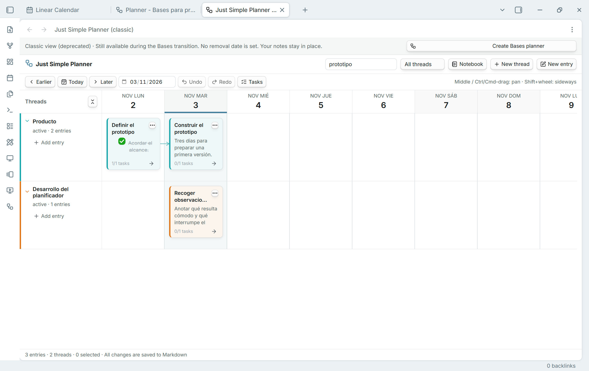
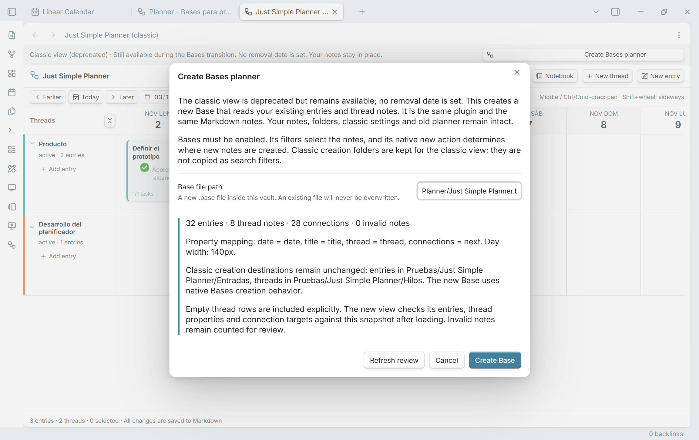
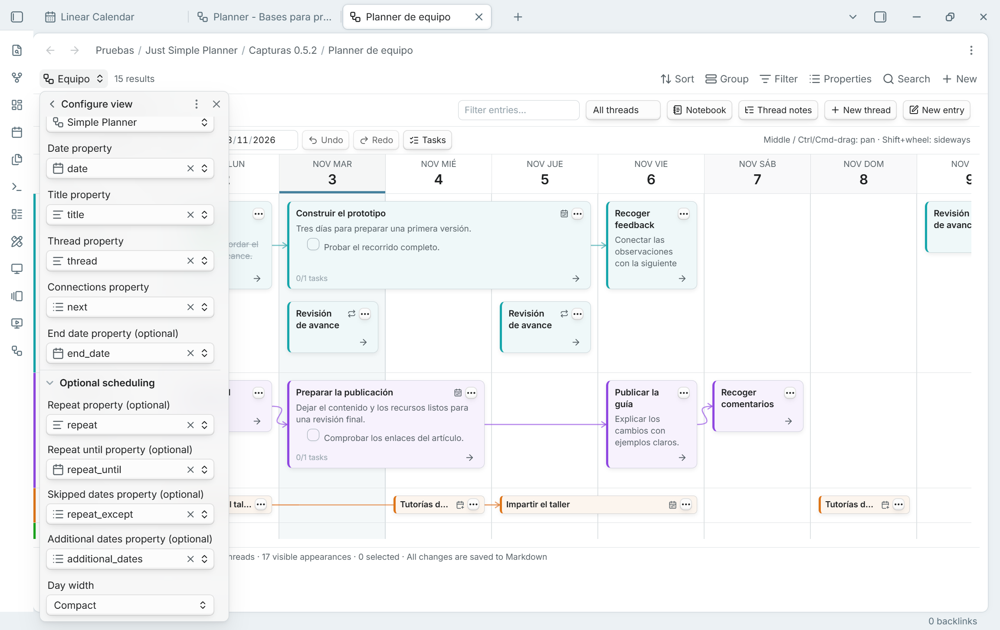

# De la vista clásica a Bases

[English guide](MIGRATION.md) · [README](../README.md)

**Usa 0.5.3 o posterior para migrar.** En 0.5.2, Create Base podía parecer habilitado e ignorar los clics. Actualiza el mismo plugin desde la [última versión](https://github.com/DavidHurtadoAI/just-simple-planner/releases/latest); las notas y los ajustes clásicos se conservan.

## Qué se depreca y qué sigue disponible

**Se depreca la vista clásica independiente, no el plugin Just Simple Planner.** La versión 0.5.2 incluye ambas infraestructuras dentro del mismo plugin, con el mismo identificador. No hay que instalar otro plugin, exportar las notas ni convertir su formato.

Para nuevos planners, la opción recomendada es el layout **Simple Planner dentro de una Base de Obsidian**. La vista clásica sigue abriéndose desde su icono y desde **Just Simple Planner: Open classic planner**. Se conservan los identificadores de los comandos y las pestañas clásicas guardadas.

**No hay fecha de retirada.** Está prevista después de validar la transición. Esta versión permite probar y comparar Bases sin perder el acceso a la vista clásica. Las nuevas funciones de repetición, fechas adicionales y duración visual pertenecen al layout de Bases; la vista clásica conserva su comportamiento anterior.

## Diferencias prácticas

| | Vista clásica | Simple Planner en Bases |
| --- | --- | --- |
| Abrir el planner | Icono o comando Open classic planner | Abrir su archivo `.base` |
| Elegir notas | Marcador `planner_type: entry` y fecha válida configurada | Consulta y límite de resultados de la Base, más una fecha válida seleccionada; no exige el marcador de entrada |
| Varios planners | Colección global con filtros de presentación | Distintos archivos Base o vistas con su consulta y configuración |
| Propiedades y ancho de día | Ajustes globales del plugin | Configure view en cada vista de Bases |
| Crear notas | Carpetas de creación clásicas | Contexto de creación nativo de Bases |
| Filas vacías | Notas de hilo encontradas globalmente | Hilos enlazados y referencias explícitas en Thread notes |
| Programación nueva | Comportamiento anterior en el día principal | Fecha final incluida, repetición, límites, exclusiones y días adicionales |
| Historial | Historial clásico en memoria | Historial independiente por cada vista abierta |

Los archivos Markdown siguen siendo la fuente de los datos. La Base guarda su consulta y configuración, no otra copia del contenido. Si dos planners usan la misma nota y propiedad de fecha, editarla cambia el mismo dato en ambos. El estado, color y orden de un hilo también se comparten cuando es la misma nota de hilo.

## Migrar un planner existente

1. **Actualiza el mismo plugin.** En instalación manual, sustituye `main.js`, `manifest.json` y `styles.css`. Conserva `data.json`, la carpeta del plugin y las notas. El mínimo declarado sigue siendo Obsidian 1.10.2; las comprobaciones de esta versión se hicieron en escritorio con 1.15.0.
2. **Activa Bases** en Settings → Core plugins. Si estaba desactivado al cargar Just Simple Planner, recarga después el plugin. Just Simple Calendar sigue siendo independiente y no es necesario.
3. **Abre la revisión de migración.** Usa **Just Simple Planner: Create Bases planner from classic notes**, **Create Bases planner** en el aviso clásico, o **Review migration** en los ajustes del plugin.
4. **Revisa los datos.** El diálogo muestra entradas, hilos, conexiones, notas inválidas, nombres de propiedades, ancho de día y destinos de creación clásicos. Si el planner cambia mientras revisas, pulsa **Refresh review**.
5. **Elige una ruta nueva dentro de la bóveda**, por ejemplo `Planner/Trabajo.base`, y pulsa **Create Base**. No se sobrescribe un archivo existente ni se permite una ruta fuera de la bóveda.
6. **Espera a la comprobación inicial.** Se comparan títulos y fechas de entradas, pertenencia a hilos, destinos de conexiones y metadatos de los hilos. Las filas vacías se conservan explícitamente. Comprueba el mensaje **Migration verified** antes de personalizar los filtros.
7. **Prueba tu trabajo habitual.** Abre notas, sigue flechas, edita una entrada y prueba Notebook, Tasks y las propiedades de Configure view. Después puedes añadir filtros o crear otros planners.

La migración crea el archivo `.base` y las carpetas padre que falten. **No mueve, renombra, duplica ni reescribe las notas existentes y no sustituye los ajustes clásicos.** Copia el mapeo de fecha/título/hilo/conexiones y el ancho de día. Si hay una vista clásica abierta, copia su estado de presentación guardado; el historial de Undo/Redo no se transfiere.

La consulta inicial selecciona los marcadores `entry` y `thread` en toda la bóveda. Las carpetas clásicas de creación quedan como información de la migración, no como filtros de búsqueda. El aviso de verificación registra la comparación inicial: no es una copia de seguridad ni una comparación continua después de cambiar deliberadamente notas o filtros.

## Activar duración y repetición

En **Configure view**, cada vista elige sus propias propiedades. La migración no adivina las propiedades opcionales de programación: selecciónalas expresamente.

- **End date property:** elige `end_date` o tu campo equivalente. Del 3 al 4 de noviembre ocupa ambos días. Los intervalos se apilan sin taparse; al mover un intervalo normal se conservan duración, horas y zona escrita.
- **Optional scheduling → Repeat property:** elige `repeat` o su equivalente. Admite, por ejemplo, `daily`, `weekly`, `monthly`, `yearly` y `every 2 weeks`.
- **Repeat until property:** último día permitido de inicio de una aparición, incluido. Un valor vacío deja la serie abierta.
- **Skipped dates property:** lista de días de inicio que se omiten, en formato `AAAA-MM-DD`.
- **Additional dates property:** días concretos para una nota de un solo día, sin repetición. Son apariciones del mismo archivo, no copias.

Las apariciones comparten archivo, contenido, selección, tareas y conexiones. Completar una tarea afecta a la tarea de esa nota; no hay un estado de finalización por cada repetición. Los enlaces siguen siendo relaciones entre notas. Editar una aparición posterior abre la nota original con su fecha principal.

El menú de la card ofrece **Repeat options…** o **Additional dates…** cuando se han seleccionado propiedades editables para los límites o listas. Cambia la fecha principal o regla de repetición en las propiedades de la nota. No se puede arrastrar una aparición programada ni un flujo que la contenga: eso modificaría la serie. El planner carga una ventana de 91 días; la navegación cambia esa ventana, también para las apariciones programadas de Notebook.

## Tener varios planners

Crea otro archivo `.base` o una vista en una Base y elige **Simple Planner**. Ponle nombre y configura filtros y propiedades. Los filtros globales de una Base siguen aplicándose a todas sus vistas; usa archivos Base distintos si quieres consultas raíz completamente independientes.

Usa **New entry** y **New thread** dentro del planner para su editor y las continuaciones conectadas. La creación usa Bases. Un filtro restrictivo puede dejar fuera una nota recién creada; el plugin no amplía la consulta por su cuenta. **Thread notes** conserva filas vacías, incluidos hilos fuera de los filtros; quitar una referencia de fila no borra la nota.

## Si algo no coincide

- **Sigue apareciendo Checking migration:** espera a la carga y compara cantidades, filtros, límite de resultados, propiedad de fecha y notas inválidas. Las diferencias deben revisarse antes de considerar verificada la migración. El planner clásico sigue disponible.
- **Falta una nota:** comprueba la consulta y su límite, la fecha seleccionada y los filtros de texto/estado del planner. Una fecha final sin fecha principal no crea una card.
- **No se mueve un flujo:** deben estar incluidos todos los sucesores resueltos. No puede contener series o días adicionales. Las propiedades calculadas se muestran, pero no se editan. Repara una fecha final inválida antes de mover el intervalo.
- **Quieres volver a la vista clásica:** abre Open classic planner; no hace falta una migración inversa para las notas clásicas originales. Las notas nuevas sin marcador, con datetime o con otro mapeo pueden no aparecer allí, porque sus reglas anteriores siguen vigentes.
- **Remove note from classic planner no excluye una nota de Bases:** solo ocurrirá si el filtro depende de ese marcador. Para otras consultas, cambia el filtro de la Base. Los menús de pertenencia y carpetas globales se identifican como clásicos por ese motivo.
- **Undo no elimina una nota nueva:** crear una nota no se deshace borrándola. Los cambios ordinarios, conexiones, tareas, movimientos y listas de programación tienen historial por vista abierta. Recargar lo vacía y cambiar el mapeo invalida el historial y los guardados de editores anteriores.

Consulta también la [introducción oficial a Bases](https://help.obsidian.md/bases) y las [pruebas y límites de esta versión](../TESTING.md).
