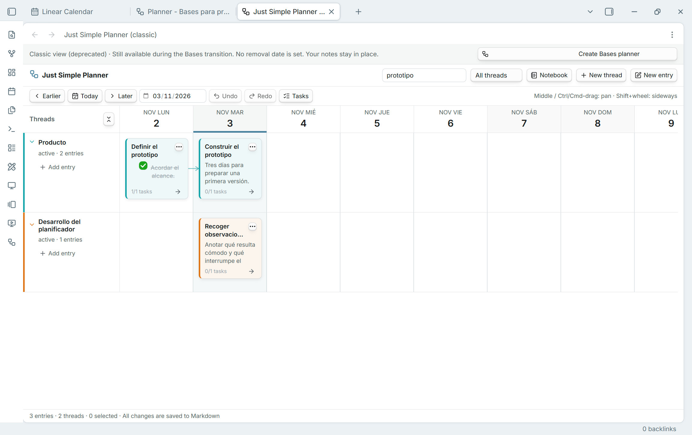
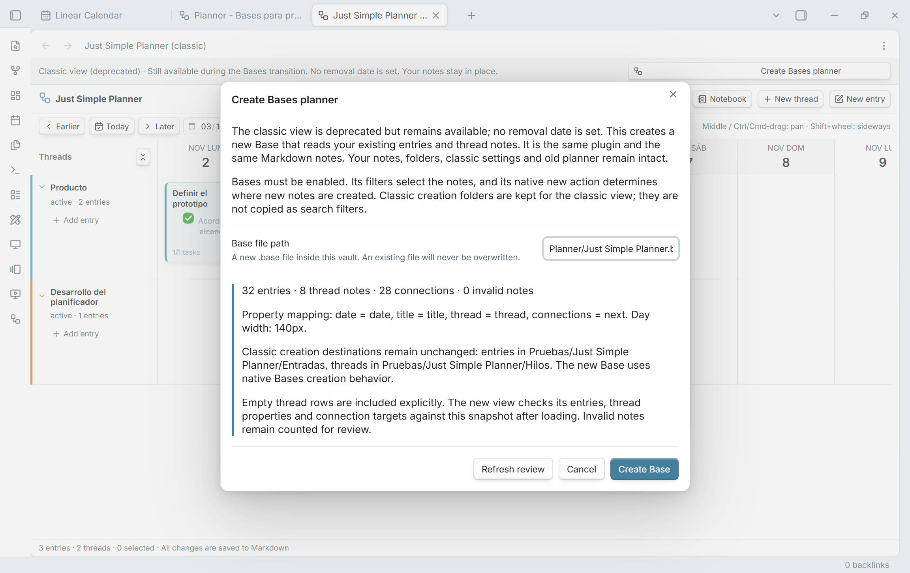
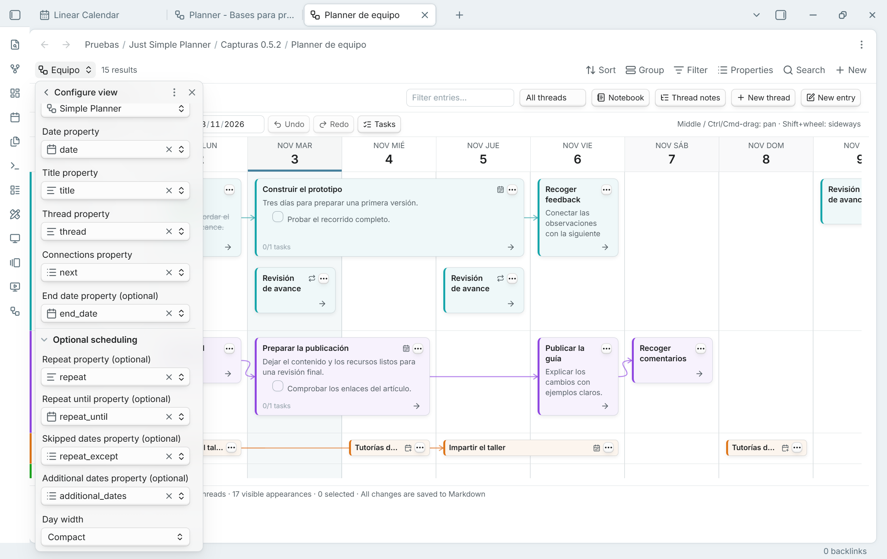

# From the classic planner to Bases

[Guía en español](MIGRACION.es.md) · [README](../README.md)

**Use 0.5.3 or later for migration.** The Create Base button in 0.5.2 could look enabled while ignoring clicks. Update the same plugin from the [latest release](https://github.com/DavidHurtadoAI/just-simple-planner/releases/latest); your notes and classic settings remain in place.

## What is deprecated?

**The standalone classic view is deprecated. Just Simple Planner itself is not.** Version 0.5.2 keeps both ways of opening a planner in the same plugin, with the same plugin ID. There is no replacement plugin to install and no note-format conversion to perform.

The recommended starting point for a new planner is the **Simple Planner layout inside an Obsidian Base**. The classic view still opens through its ribbon icon and **Just Simple Planner: Open classic planner**. Existing command IDs and saved classic tabs are retained. This release does not remove or automatically replace them.

**No removal date has been set.** Retirement is planned after the Bases transition has been validated. Use this release to try and compare the new view while keeping the classic view available. Repetition, additional dates and multi-day card rendering described here belong to the Bases layout; the classic view retains its previous scheduling behavior.

## What changes in everyday use?

| | Classic view | Simple Planner in Bases |
| --- | --- | --- |
| Open a planner | Ribbon icon or Open classic planner | Open its `.base` file and select Simple Planner |
| Select notes | `planner_type: entry` plus a valid configured date, anywhere in the vault | The Base's query and result limit, plus a valid selected date; an entry marker is not required |
| Several planners | One global source collection with view filters | Different Base files or views, with their own queries and configuration |
| Property mapping and day width | Plugin settings | Configure view in each Base view |
| Where new notes go | Classic entry/thread creation folders | Native Bases creation context |
| Empty rows | Marked thread notes discovered globally | Linked thread notes and explicit Thread notes references for that view |
| New scheduling | Previous main-day behavior | Inclusive end dates, repetitions, limits, skipped days and additional dates |
| Undo/redo | Classic in-memory history | A separate in-memory history for each open planner view |

The Markdown files remain the source of truth. A Base stores its query and view configuration, not a second copy of the note bodies. Editing a shared note changes that note wherever it appears, including another planner or calendar using the same properties. Thread status, color and order are also shared when views use the same thread note.

## Migrate an existing classic planner

1. **Update the same plugin.** With manual installation, replace the three release files: `main.js`, `manifest.json` and `styles.css`. Keep `data.json`, your notes and existing plugin folder. The declared minimum remains Obsidian 1.10.2; the desktop checks for this release ran on 1.15.0.
2. **Enable Bases** in Settings → Core plugins. If it was disabled when Just Simple Planner loaded, reload Just Simple Planner afterward. Just Simple Calendar is a separate plugin and is not required.
3. **Open the migration review.** Run **Just Simple Planner: Create Bases planner from classic notes**, click **Create Bases planner** in the classic banner, or choose **Review migration** in the plugin settings.
4. **Read the review.** It shows entry, thread and connection counts, invalid notes, current property names, day width and the classic creation destinations. If the classic planner changes during the review, use **Refresh review** before creating the Base.
5. **Choose a new vault-relative path**, for example `Planner/Work.base`, and click **Create Base**. The tool refuses an existing destination or a path outside the vault.
6. **Wait for the migration status in the new view.** The first successful comparison checks entry titles/dates, thread membership, connection targets and thread metadata against the classic snapshot. Empty thread rows are explicitly retained. Confirm **Migration verified** before tailoring the query.
7. **Compare your usual workflow.** Open notes, follow arrows, edit an entry, try Notebook and Tasks, and check the properties selected under Configure view. Then add Base filters or create another planner as needed.

Migration creates the new `.base` file and any missing parent folders. **It does not move, rename, duplicate or rewrite your existing notes, and it does not replace classic settings.** Date/title/thread/connections mappings and day width are copied. A saved classic view state is copied when a classic view is open; undo history is not transferred.

The initial query selects the existing `entry` and `thread` markers across the vault. Classic creation folders are retained as migration information, not turned into folder filters. After verification, the Base can be filtered independently. The verified banner records that initial comparison; it is not a backup or an ongoing equality check after you intentionally change filters or notes.

## Configure the new features

Open **Configure view** for the Simple Planner view. Its property selections belong to that view.

- **End date property:** select your end-date field, such as `end_date`. November 3 through November 4 occupies both day columns. Overlapping ranges stack; moving an ordinary range preserves both dates, duration and written time/offset. Optional schedule properties are not guessed during migration: select them explicitly.
- **Optional scheduling → Repeat property:** select `repeat` or your equivalent field. Supported examples include `daily`, `weekly`, `monthly`, `yearly` and `every 2 weeks`.
- **Repeat until property:** the final allowed occurrence start day, included. Leave the value empty for an open-ended series.
- **Skipped dates property:** a list of occurrence start days to omit, in `YYYY-MM-DD` format.
- **Additional dates property:** individual `YYYY-MM-DD` days for a single-day note without repetition. These are separate appearances of the same file.

Repeated appearances share the original file, contents, selection, tasks and connections. Completing a task completes that note's task; it does not create a separate completion record for each occurrence. Connections remain note-level relations. Editing a later appearance opens the original note and main date.

Use **Repeat options…** or **Additional dates…** in the card menu when writable limit/date-list properties have been selected. Change the main anchor date or repeat rule in the note's properties. Dragging a repeating or additional-date note, or a flow containing one, is disabled to avoid changing a whole schedule accidentally. The board loads a 91-day window; date navigation changes it, including scheduled Notebook appearances.

## Make several planners

Create another `.base` file, or another view in a Base, and choose **Simple Planner**. Give it a useful name and set its filters and property mappings. Use the Base's own note selection rather than the old global folder settings. Filters shared by all views in a Base still apply; use separate Base files when you want completely separate root queries.

The same note can appear in several planners. This does not duplicate the file. Different views can choose different date fields; views that choose the same field share its changes. The built-in Bases Group control does not replace the planner's Thread property.

Use **New entry** and **New thread** inside the planner for its editor and connected continuations. They use native Bases creation. A restrictive query can exclude a newly created file; the plugin does not silently widen the query. Use **Thread notes** to keep empty thread rows, including thread notes outside the query. Removing a row reference does not delete the thread note.

## Questions and checks

**The migration status stays on Checking migration.** Allow the query and Markdown bodies to load. Compare the review counts with the view, check the Base's filters/result limit and date mapping, and inspect invalid-note counts. Invalid dates, excluded files or changed notes can prevent the initial match. Review those differences before treating the migration as verified; the original planner remains available.

**A note is missing from a new planner.** Check the Base query, its result limit and the selected Date property. A Markdown note needs a valid selected date. Then check the planner's own text/status filters. An end date alone cannot create a card.

**A connected flow cannot move.** All resolved successors must be included in the Base, and the flow cannot contain a repeating/additional-date schedule. Computed properties can be displayed but cannot be edited. Invalid end dates must be repaired before moving a range.

**Can I keep using classic?** Yes, through Open classic planner. No reverse migration is necessary for the original classic notes. A newly selected unmarked note, a datetime date, a different property mapping or a repeated appearance in Bases need not appear in classic, whose original membership/date rules still apply.

**Does Remove note from classic planner exclude it from Bases?** Only if that Base's filter depends on the removed marker. For other queries, change the Base filter. File-explorer membership actions and global creation-folder settings are labeled classic because that is their scope.

**Can I undo a newly created note?** Creation is not undone by deleting the file. Ordinary edits, connections, tasks, moves and schedule-list changes have exact-snapshot undo/redo within their open view. History is cleared on reload, and property-mapping changes invalidate the old history and old editor saves.

For the host feature itself, see [Obsidian's introduction to Bases](https://help.obsidian.md/bases). For this release's checks and remaining platform limits, see [TESTING.md](../TESTING.md).
