# Your first Just Simple Planner

**A complete, illustrated walkthrough: open a working example, build your own planner, and learn the everyday workflow.**

[Back to the README](../README.md) · [Download the starter pack](https://github.com/DavidHurtadoAI/just-simple-planner/raw/refs/heads/main/docs/downloads/planner-tutorial.zip) · [Browse its notes](../examples/tutorial) · [Migrating from classic?](MIGRATION.md)

You will plan a small fictional project: define an objective, draft a proposal, review it with a team, and publish the result. Along the way you will create notes, connect steps, change dates, complete tasks and see the underlying Markdown.

**Start with [the ready-made example](#1-open-a-working-planner)** if you want a result immediately. Follow [the build-it-yourself route](#2-build-your-own-planner-from-zero) when you are ready to make one for your own work. Both routes teach the same current **Simple Planner layout inside Obsidian Bases**.

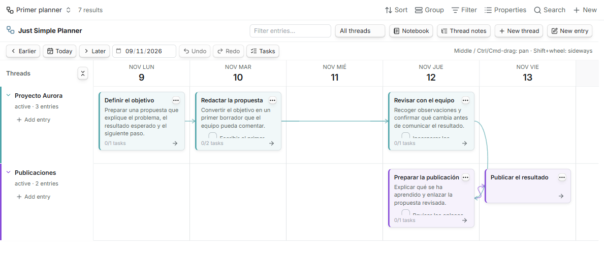

*This is the result you are working toward. Every card is an ordinary Markdown note; the arrow between the two rows connects work across projects.*

## Choose your route

| What you want to do | Start here |
| --- | --- |
| See a functioning planner in a few minutes | [1. Open a working planner](#1-open-a-working-planner) |
| Build an empty planner for your own notes | [2. Build your own planner from zero](#2-build-your-own-planner-from-zero) |
| Create rows, cards and connected next steps | [3. Create your first thread and entries](#3-create-your-first-thread-and-entries) |
| Move dates, connect existing cards and follow a story | [4. Plan and replan](#4-plan-and-replan) |
| Read a project and work through its tasks | [5. Use Notebook and Tasks](#5-use-notebook-and-tasks) |
| Understand the files or reuse existing notes | [6. Your notes remain your notes](#6-your-notes-remain-your-notes) |
| Use date ranges, repetitions or several planners | [7. Go further](#7-go-further) |
| Fix an empty board or another unexpected result | [8. Troubleshooting](#8-troubleshooting) |
| Find a gesture quickly | [9. Mouse and keyboard reference](#9-mouse-and-keyboard-reference) |

## Before you start

You need **Obsidian 1.10.2 or later**, **Just Simple Planner 0.5.6 or later**, and Obsidian's built-in **Bases** plugin enabled under **Settings → Core plugins**. Just Simple Calendar is independent and is not required. Enable the core **Page preview** plugin too if you want note previews on hover.

If Just Simple Planner is not installed:

1. Open the [latest GitHub release](https://github.com/DavidHurtadoAI/just-simple-planner/releases/latest).
2. Download **`main.js`**, **`manifest.json`** and **`styles.css`** from **Assets**. The GitHub source-code ZIP is the development repository; use the three installable files for the plugin.
3. In your vault's configuration folder, normally `.obsidian`, create `plugins/just-simple-planner/` and place the three files directly inside it.
4. Reload Obsidian and enable **Just Simple Planner** under **Community plugins**. If you enabled Bases after the planner loaded, reload the planner afterward.

When updating, replace those three files and retain your notes and `data.json`. The [README's installation section](../README.md#install) also covers release verification.

**Open a `.base` file for this tutorial.** The planner ribbon icon opens the retained, deprecated **classic** view. Properties for the current layout are configured in the Base's **Configure view** panel; the plugin's global settings describe classic behavior.

The guide is in English and uses the exact English control labels. Sample notes and filenames are Spanish, so you can recognize them in the screenshots. Their meaning is explained as they appear. All sample work is fictional. Your own notes can use any language.

## The three things to understand

| On the screen | In your vault | What it means |
| --- | --- | --- |
| A **card**, also called an **entry** | One `.md` note with a date | Something that happened or a next step: a meeting, draft, decision or activity. It can contain prose, links and tasks. |
| A **thread row** | A linked thread note, or a text value in `thread` | A continuing story such as a project or area of work. Thread notes also store color, status and order. |
| An **arrow** | A wikilink in the source note's `next` list | A connection to a following note. It can cross into another thread. |

The **Base** is the saved query and view configuration. Its filters decide which notes are selected. The selected Date property places entries on days; the Thread property places them in rows. A folder can be used as a Base filter, but moving a file between folders does not itself assign a thread.

Arrows describe how work continues. They do not automatically reschedule successors when you move one card; you choose whether to move one card or a connected flow.

## 1. Open a working planner

### Download and open the example

1. [Download the tutorial starter ZIP](https://github.com/DavidHurtadoAI/just-simple-planner/raw/refs/heads/main/docs/downloads/planner-tutorial.zip) and extract it outside your vault.
2. Copy the extracted **`Planner tutorial` folder** into the **root of your existing vault**. The root is the folder containing your vault's configuration directory. Keep the folder name: the example's filters and links use it. If that destination already exists, use your existing copy or deliberately update the paths; do not overwrite notes you have edited.
3. In Obsidian's file explorer, open **`Planner tutorial/Primeros pasos/Primer planner.base`**.
4. In the planner's date field, **Go to date**, select **9 November 2026** (`2026-11-09`). The date picker follows your computer's locale.

The fixed dates let the screenshots and instructions stay reproducible when you read this later. **Today** returns to your actual current date; use **Go to date** to return to the example. If your window shows fewer days, pan horizontally until November 9 is near the left edge to see the five-day story together.

**Checkpoint:** you should see **five entries, two thread rows and four arrows**, including a connection across rows. The Base toolbar says **7 results** because its query selects five entry notes and two thread notes. The planner footer counts the five cards separately. **Tasks** shows five pending checkboxes.

| Row | Card | Meaning | Date |
| --- | --- | --- | --- |
| Proyecto Aurora | Definir el objetivo | Define the objective | November 9 |
| Proyecto Aurora | Redactar la propuesta | Draft the proposal | November 10 |
| Proyecto Aurora | Revisar con el equipo | Review with the team | November 12 |
| Publicaciones | Preparar la publicación | Prepare the publication | November 12 |
| Publicaciones | Publicar el resultado | Publish the result | November 13 |

If the board is empty, check the folder nesting first. It must be `your vault/Planner tutorial/Primeros pasos/...`, without an extra ZIP-name folder in between. Then check that Bases and the plugin are enabled and that **Go to date** is set to the example week.

### Try three things immediately

1. **Double-click `Redactar la propuesta`.** Its editor shows the title, date, thread and Markdown body. Close with **Cancel** for now.
2. **Drag that card one day to the right.** Its date changes from November 10 to November 11. Click **Undo** in the planner to put it back.
3. Click **Tasks**, complete one checkbox, then click **Undo**. The task is stored in the source note and appears again when you undo completion.

You already have the everyday cycle: capture a note, place it in time, connect it to what follows, and adjust the plan. Continue at [section 3](#3-create-your-first-thread-and-entries) to add your own content, or build a separate empty planner below.

## 2. Build your own planner from zero

This route creates a separate folder named **`Mi primer planner`** ("My first planner"). It leaves the downloaded example available for comparison.

### Create the folder and Base

1. Create **`Mi primer planner`** at your vault's root.
2. Right-click that folder in Obsidian's file explorer and choose **New base**. Name the file **`Mi primer planner.base`**. You can also run **Bases: Create new base** from the command palette; check that the file is in the intended folder. See [Obsidian's Base creation help](https://help.obsidian.md/bases/create-base) for these host controls.
3. Open the view-name menu at the top left of the Base. Choose **Add view**, then choose **Simple Planner** as its **Layout**. You can also configure the existing view and change its Layout to **Simple Planner**.
4. Name the view **My planner**.

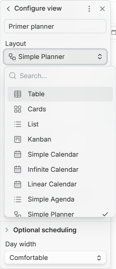

*The layout is named Simple Planner. Other installed layouts may appear in your list.*

**Shortcut:** you can [download a prepared empty Base](https://github.com/DavidHurtadoAI/just-simple-planner/raw/refs/heads/main/docs/downloads/First%20planner.base), place it inside `Mi primer planner`, and open it. It already has the filters and four property mappings described next. This is an empty view definition, not a new vault.

### Select the notes this planner should contain

Click **Filter** in the Base toolbar and expand **All views**. Set up this rule:

```text
All the following are true
  file  in folder  Mi primer planner
  Any of the following are true
    planner_type  is  entry
    planner_type  is  thread
```

Use **Add filter** for the folder condition, then **Add filter group** for the nested group. Set that group to **Any of the following are true**, and add the two `planner_type` conditions inside it. If the editor shows an unused empty placeholder condition, leave it unused rather than entering an unrelated rule.

The folder condition scopes this particular example. The nested group allows either kind of planner note: an entry **or** a thread. A note does not need both values. Use the property **`planner_type`**, spelled exactly this way; its two values here are `entry` and `thread`.

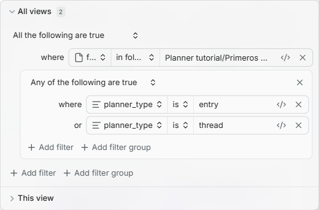

*The downloadable example uses `Planner tutorial/Primeros pasos`; your empty planner uses `Mi primer planner`. The filter structure is the same.*

<details>
<summary>If the properties do not appear in the picker yet</summary>

Create one ordinary note named `Propiedades del planner.md` inside `Mi primer planner` and paste this in **Source mode**, including both `---` lines:

```yaml
---
planner_type: tutorial_setup
date: 2026-11-09
title: Propiedades del planner
thread: ""
next: []
---
This note makes the property names available during setup.
```

Return to the Base and reopen the property picker. This setup note can stay in the folder: the entry-or-thread filter excludes `tutorial_setup`. It is not a card or a thread.

</details>

<details>
<summary>The exact .base file, if you prefer to inspect or copy it</summary>

Save the following as `Mi primer planner.base` inside the `Mi primer planner` folder using a plain-text editor. The filename must end in `.base`, without an extra `.txt` extension. The prepared download above contains this same configuration.

```yaml
filters:
  and:
    - file.inFolder("Mi primer planner")
    - or:
        - note.planner_type == "entry"
        - note.planner_type == "thread"
views:
  - type: just-simple-planner-bases
    name: My planner
    dateProperty: note.date
    titleProperty: note.title
    threadProperty: note.thread
    nextProperty: note.next
    dayWidth: "190"
```

</details>

### Check the four properties

Open the Base's view-name menu again, then the arrow or configuration control beside the active view to reach **Configure view**. With **Layout: Simple Planner**, use:

| View option | Property |
| --- | --- |
| Date property | `date` |
| Title property | `title` |
| Thread property | `thread` |
| Connections property | `next` |
| End date property (optional) | Leave unselected for now |
| Optional scheduling | Leave unselected for now |
| Day width | Comfortable |

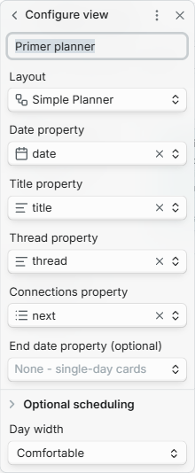

The first four keys are also the defaults if you leave those selectors unconfigured. Choose your own existing property names later if needed. Each selected property must have a distinct name. **The Date property is essential:** a selected note without a valid date cannot appear as an entry.

These choices are saved in this Base view. Changing a selector changes how notes are interpreted; it does not rename properties in existing files. Use writable note properties for actions that edit dates, threads or connections.

**Checkpoint:** an empty timeline or its help message is expected. You have created the view and its scope; the next step creates its content.

## 3. Create your first thread and entries

### Create a thread row

1. Click **New thread** in the planner toolbar.
2. Set **Title** to `Proyecto Aurora`.
3. Choose **Color: Cyan** and **Status: Active**.
4. Click **Create**.

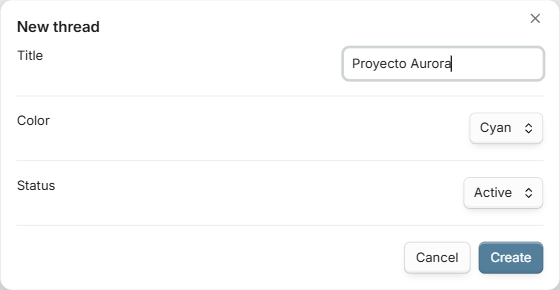

**Checkpoint:** a colored row named **Proyecto Aurora** appears, initially with no entries. The action creates a real Markdown thread note and retains the row for this view. The folder does not decide the row: an entry's `thread` property will link to this note.

### Create the first card

1. Click **Add entry** beside **Proyecto Aurora**, or click **New entry** and select that thread in the editor.
2. Set **Title** to `Definir el objetivo`.
3. Set **Date** to **9 November 2026** (`2026-11-09`). A new entry initially uses today's date, so set this explicitly when following the example.
4. Confirm **Thread: Proyecto Aurora**.
5. Paste this in **Markdown**:

```markdown
Preparar una propuesta que explique el problema, el resultado esperado y el siguiente paso.

- [ ] Acordar el resultado esperado.
```

6. Click **Save**, then use **Go to date** to navigate to November 9 if needed.

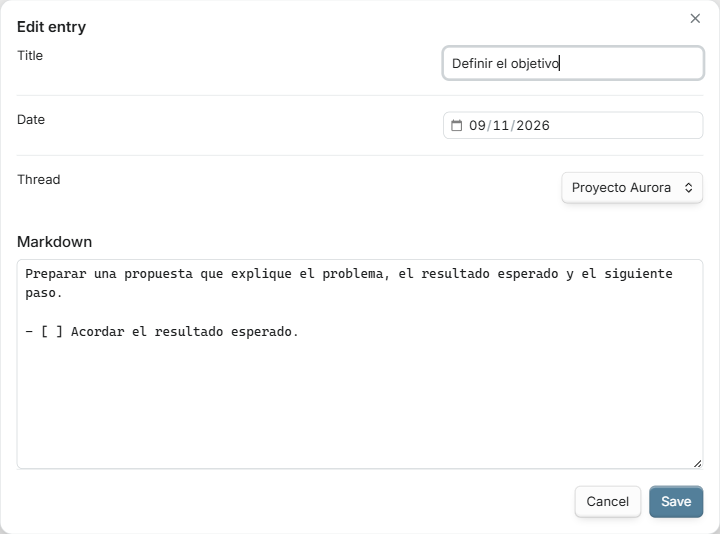

**Checkpoint:** one card appears in the Proyecto Aurora row on November 9. Its task summary shows `0/1 tasks`. The actual Markdown note is visible in the file explorer. A card with no Markdown body is shorter; adding content gives it the normal preview height.

**Where does the file go?** The planner uses native Bases note creation. Bases chooses the folder/name and applies its creation context. The simple folder filter used here gives newly created notes a matching destination. More elaborate queries can exclude a new note after it is created; the planner does not silently change those filters. Its **New entry** and **New thread** buttons provide the planner editors; the separate **New** button in the Base toolbar follows Obsidian's ordinary creation behavior and may leave the date unset.

### Add a connected next step

1. Open the first card's **three-dot menu** and choose **Add connected entry**. You can also select the card and press **Tab**, or use the small continuation arrow at its bottom right.
2. The editor inherits the same thread and the **following day**, November 10.
3. Set **Title** to `Redactar la propuesta` and add:

```markdown
Convertir el objetivo en un primer borrador que el equipo pueda comentar.

- [ ] Escribir el primer borrador.
- [ ] Comprobar los ejemplos.
```

4. Save. An arrow connects the first card to the second.
5. From the new card, choose **Add connected entry** again. Name it `Revisar con el equipo`, change its date to **November 12**, add `- [ ] Incorporar los comentarios.` in its body, and save.

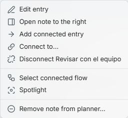

**Checkpoint:** your first row has three dated cards and two arrows. The gap between November 10 and November 12 is deliberate; a connection does not require consecutive days.

### Connect two threads

Create another thread called **Publicaciones**, choose **Purple**, and add:

| Entry | Date | Markdown |
| --- | --- | --- |
| `Preparar la publicación` | November 12 | `- [ ] Revisar los enlaces.` |
| `Publicar el resultado` | November 13 | Leave empty for a short card |

Use **Add connected entry** from the first publication card to create the second. Then open **Revisar con el equipo → Connect to…** and choose **Preparar la publicación**. That adds the cross-thread connection shown in the opening screenshot.

**Checkpoint:** five cards, two rows, four arrows and five pending tasks. You have built the same structure as the starter pack.

## 4. Plan and replan

### Connect existing cards with the mouse

Hover over a card to reveal the **+ handle on its right edge**. Drag from that handle onto another card and release when the destination highlights. This writes a normal link in the source note's `next` list. Use **Connect to…** from the card menu if you prefer choosing from a list.

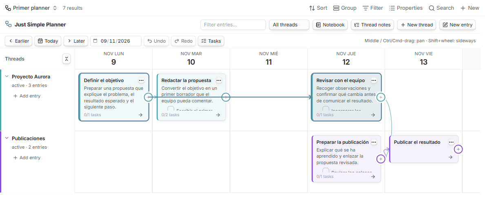

*This example previews an extra connection from the objective to the review. Release to save it, or press Escape to cancel.*

To remove an arrow, hover over the line and click **×**, or use **Disconnect…** in the source card's menu. The source and destination notes remain. **Undo** restores the connection. Dropping on empty space or pressing **Escape** cancels a connection gesture.

### Move one card

Left-drag a card to another day. Dragging a single card into another row also changes its thread. The note itself is updated; other views that use the same date or thread properties see that edit too.

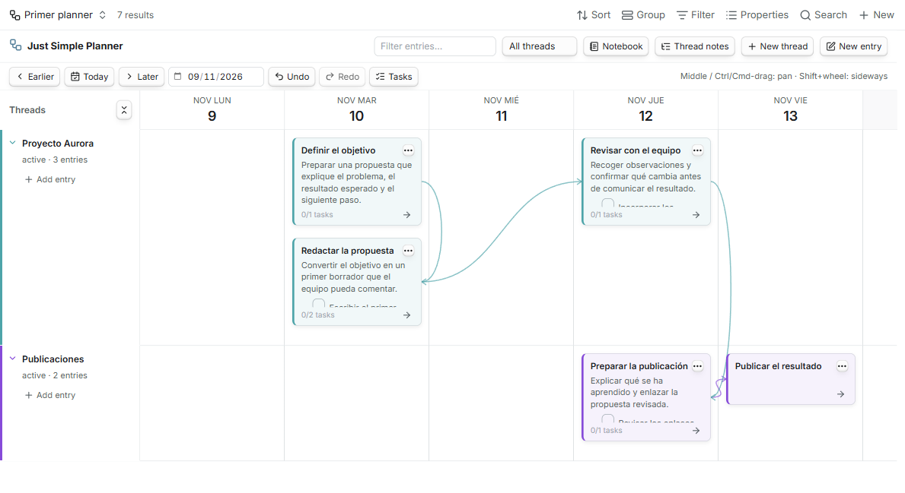

*Two entries on one day stack vertically. The moved card remains connected to its following step.*

For a small keyboard adjustment, select a card and press **Ctrl/Cmd + Left** or **Ctrl/Cmd + Right** to move it by one day. Click **Undo** to restore its previous date.

### Move a connected flow

Suppose the proposal starts two days later and you want to retain the spacing of the following work:

1. Open **Definir el objetivo → Select connected flow**.
2. The card and its connected successors are selected, including branches and the publication cards in the other row.
3. Drag the selection two days to the right. Every selected date shifts by the same amount, preserving the gaps.
4. Click **Undo** to return the complete flow to its original dates.

**Shift-drag** from a card is the shortcut for moving it with its successors. To select an arbitrary set instead, use **Ctrl/Cmd-click** on individual cards.

A whole-flow move requires all resolved successors to be included in the Base results. If the planner reports an outside connection, include those notes in the query before moving the whole flow. A flow containing a repeating or additional-date note cannot be dragged; edit that note's schedule instead.

### Follow one story or make room

Choose **Spotlight** from a card's menu to highlight its ancestors and following branches while dimming unrelated work. **Clear focus** or **Escape** returns to the full view.

All five notes in the beginner example are connected, so they all belong to the highlighted story. To see the dimming, temporarily disconnect **Revisar con el equipo → Preparar la publicación**, activate Spotlight on the review, then use **Clear focus** and **Undo** to restore the connection.

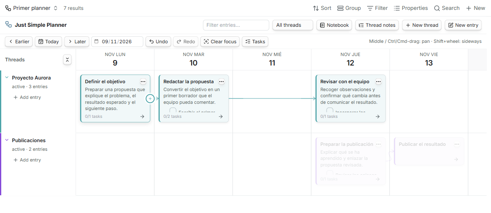

Click the chevron beside a thread name to fold it. Cards become compact title strips, retaining their dates, arrows, menus and dragging. Expand it to return to full previews.

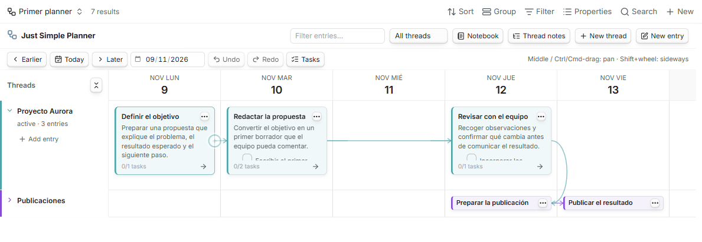

Folding changes the view. A thread's **Active**, **Parked** or **Closed** status is separate: right-click the thread label to set its status or move it up/down. The toolbar's **All threads** selector can show a particular status. Thread-note metadata is shared by views using that note.

### Keep navigation simple

Use **Go to date**, **Today**, **Earlier** and **Later** to navigate. Scroll horizontally with **Shift + wheel**, or pan with the **middle mouse button** or **Ctrl/Cmd + left-drag**. Plain left-drag on a card changes the plan, so use a pan gesture when your intention is to move the viewport.

The planner's **Filter entries…** field searches titles and Markdown bodies. This is separate from the Base toolbar's **Search**, which searches its displayed properties. Clear filters when you want the full selected collection again.

## 5. Use Notebook and Tasks

Click **Notebook** to read a thread as a chronological journal. Choose its thread in the notebook's selector. Click **Board** to return to the timeline.

Click **Tasks** to open the pending-task rail in either mode. It gathers Markdown checkboxes from the current planner filters. Completing one writes `[x]` into the original note; **Undo** restores `[ ]`.

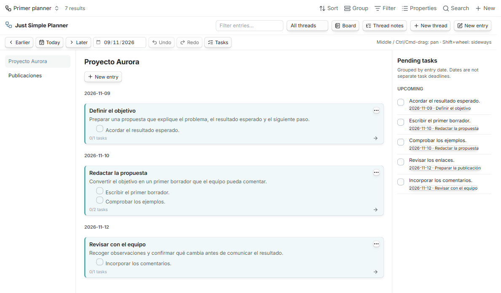

The tasks are grouped by the **entry's date**. A checkbox has no independent deadline here. Two tasks inside a November 10 note both belong to that entry's date; the planner does not interpret Tasks-plugin due-date syntax. Fenced-code examples are ignored when collecting checkboxes.

**Try it:** complete `Acordar el resultado esperado.` in the rail. Open its source note to see the changed checkbox. Return to the same open planner and click **Undo**. The checkbox becomes pending again.

Hover a card for Obsidian's native note preview, including properties and content. Enable **Page preview** first; its **Just Simple Planner** source controls whether a modifier key is required. Card buttons and links retain their own actions.

## 6. Your notes remain your notes

### Inspect the underlying Markdown

Open a card's menu and choose **Open note to the right**. The board and the note show the same data. In the Markdown pane, switch to **Source mode** if you want to inspect the property block literally.

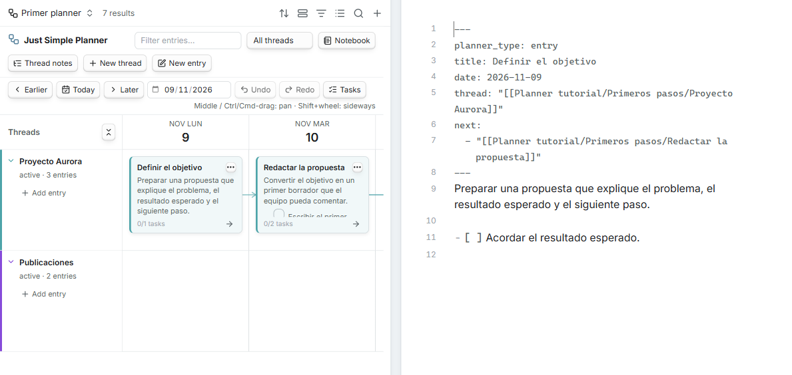

For example, the starter pack's first card is a note with this structure:

```markdown
---
planner_type: entry
title: Definir el objetivo
date: 2026-11-09
thread: "[[Planner tutorial/Primeros pasos/Proyecto Aurora]]"
next:
  - "[[Planner tutorial/Primeros pasos/Redactar la propuesta]]"
---
Preparar una propuesta que explique el problema, el resultado esperado y el siguiente paso.

- [ ] Acordar el resultado esperado.
```

| Property | Purpose |
| --- | --- |
| `planner_type: entry` | Includes this note in the marker-based query used by this tutorial. |
| `date` | Places the card on the timeline. Use `YYYY-MM-DD`; the Bases layout also accepts supported datetimes. |
| `title` | Displays the card title. Missing or blank values fall back to the filename without `.md`, including any date prefix in the filename. Editing the title does not rename the file. |
| `thread` | Links to the note defining its row. A plain-text group name is also supported. |
| `next` | A YAML list of wikilinks to following entries. More than one link creates a branch. |

A thread note uses `planner_type: thread`, with `status`, `color` and `order`. The plugin's dialogs write these properties for you. When pasting YAML manually, retain the `---` delimiters, indentation, and quotes around wikilinks.

### Bring an existing note into the planner

For the marker-based query in this tutorial:

1. Make sure the existing note is inside the folder selected by this Base. If you want notes from other folders, change the Base's filters deliberately.
2. Add **`planner_type: entry`**, a valid **`date`**, and **`thread`** linking to the intended thread note. Use Obsidian's Properties editor or Source mode.
3. Return to the Base and navigate to that date. The same file appears as a card. Its existing prose, tasks and other properties remain in place.

You can also drop an existing Markdown note onto the planner to open its **Add note to planner** review. Review the date and thread before saving: changing the selected date property changes that same property in other views. The review updates the existing file; it does not override the Base's folder filter or duplicate the note.

Bases can also select **unmarked** dated notes through a custom query. The layout itself does not impose an extra hidden marker requirement. We use explicit markers here to make membership, removal and the beginner example predictable. File-explorer membership actions labeled **classic** belong to the old view; use the current Base's query or its in-view review.

### Remove a card while keeping its note

Open its right-click or three-dot menu and select **Remove note from planner…**. Read the review and click **Remove from planner**.

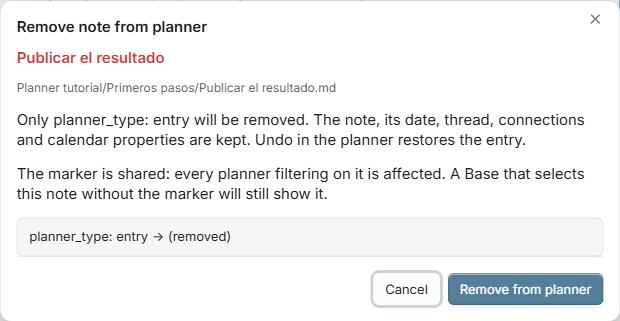

This removes only **`planner_type: entry`**. With this tutorial's marker-based filter, the card disappears and the file remains. **Undo** in the same open planner restores it.

The marker belongs to the note, so every planner filtering on that marker is affected. A Base selecting the note through other criteria can continue displaying it. The action is disabled for an unmarked card. Deleting the file from Obsidian's file explorer is a separate action that deletes the source note.

### Know what Undo can restore

Edits, moves, connections, task completion, membership changes and supported schedule-list changes have **Undo/Redo inside the open planner view**. Each open view has its own history. Reloading clears it, and changing the property mapping invalidates old history. If a note changes elsewhere, the planner refuses an outdated write rather than replacing the newer text.

Creating a note is not undone by deleting it. If you create a card by mistake, remove its marker to keep the note outside this planner, or manage the file deliberately in Obsidian.

## 7. Go further

The starter pack includes **`Planner tutorial/Avanzado/Planner avanzado.base`**. Open it and go to **November 9, 2026**. Its three source notes demonstrate the options below using the same two thread notes.

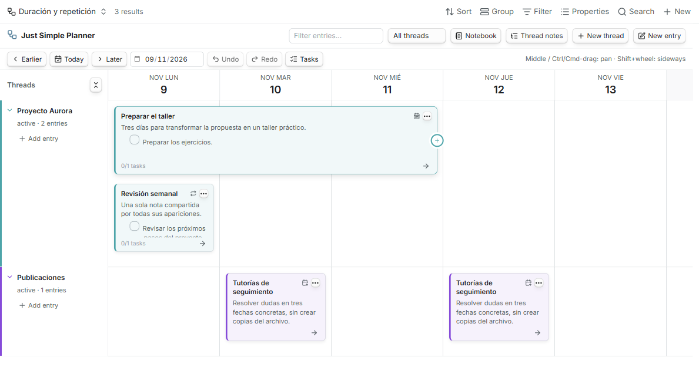

### Show an activity across several days

In **Configure view**, select **End date property (optional): `end_date`**. Add an end date to the source note:

```yaml
date: 2026-11-09
end_date: 2026-11-11
```

The end day is **inclusive**: this occupies November **9, 10 and 11**. The advanced note **Preparar el taller** demonstrates it. Overlapping cards stack. Moving an ordinary multi-day card shifts both dates and preserves its duration, including when you grab it from a later day. Supported written times and UTC offsets are preserved too.

An invalid end date shows a warning and a one-day card; repair it before moving the range. A formula-derived date can be displayed, but edits require writable note properties.

### Repeat one note

Select the optional properties for this Base view:

| View option | Example property |
| --- | --- |
| End date property (optional) | `end_date` |
| Optional scheduling → Repeat property (optional) | `repeat` |
| Repeat until property (optional) | `repeat_until` |
| Skipped dates property (optional) | `repeat_except` |
| Additional dates property (optional) | `additional_dates` |

The Repeat until and Skipped dates selectors appear after a Repeat property is selected. If an optional key is not listed yet, add it to a note's properties and reopen Configure view.

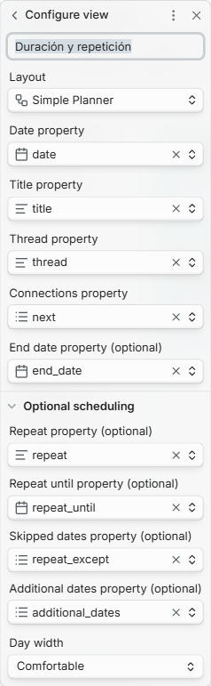

The advanced **Revisión semanal** note contains:

```yaml
date: 2026-11-09
repeat: weekly
repeat_until: 2026-11-30
repeat_except:
  - 2026-11-16
```

**Expected result:** appearances on **November 9, 23 and 30**. November 16 is skipped; November 30 is included. The weekly note remains **one file**. Navigate to the later weeks to see the other appearances.

Supported rule examples include `daily`, `weekly`, `monthly`, `yearly` and `every 2 weeks`; compact forms such as `w2` are also accepted. A month-end recurrence uses the final available day in shorter months, anchored to the original date.

Use the card menu's **Repeat options…** to edit configured, writable limits and skipped-date lists. Change the main date and repeat rule in the original note's properties.

### Show one note on a few irregular dates

The **Tutorías de seguimiento** note uses:

```yaml
date: 2026-11-10
additional_dates:
  - 2026-11-12
  - 2026-11-17
```

**Expected result:** one source note appears on **November 10, 12 and 17**. Additional dates are individual days for a **single-day note without repetition**. Use **Additional dates…** in the card menu when a writable additional-date property has been configured.

**Shared-note behavior matters:** repeated or additional-date appearances share the body, tasks, selection and connections of the same file. Completing a checkbox completes that source task everywhere; there is no separate completion record for each occurrence. Editing a later appearance opens the original note and its main date. Connections are note-level relationships, not one relation per appearance.

Dragging scheduled notes, or a flow containing them, is disabled. Edit the original date or schedule instead. The planner loads a **91-day window** for scheduling; date navigation changes that window. Invalid schedules show warning badges and details in the footer tooltip.

### Keep several planners

Create separate `.base` files for different root queries, such as work and personal notes. Choose **Simple Planner** in each and configure their own filters and property mappings. You can also add several views to one Base, but **All views** filters are shared by those views.

A note can appear in several planners without being copied. Views using the same date property see the same date changes. Views using the same thread note share that row's status, color and order. Native Bases **Group** does not replace the planner's Thread property.

For an empty row that should stay visible even outside the query, click **Thread notes → Add row**, choose a Markdown note with `planner_type: thread`, and save. **Remove row** removes that view's explicit reference, without deleting the note. A linked or query-selected thread can still supply the row independently.

### If you already use the classic planner

Follow the [complete migration guide](MIGRATION.md) or [guía en español](MIGRACION.es.md). Run **Just Simple Planner: Create Bases planner from classic notes**, review the counts and destination, create a new Base and wait for **Migration verified** before tailoring it.

Migration reads the existing notes and creates a Base; it does not move or rewrite the notes. The classic view remains available during the transition, with no removal date set. Optional scheduling properties must be selected explicitly in the new view.

## 8. Troubleshooting

| What you see | What to check |
| --- | --- |
| Simple Planner is absent from Layout | Enable the core Bases plugin and Just Simple Planner. Reload the planner if Bases was enabled after it loaded. Confirm the installed planner version is 0.5.6 or later. |
| The classic deprecation banner appears | You opened the ribbon/classic view. Open your `.base` file and choose its Simple Planner layout, or use the migration guide for an existing classic collection. |
| The starter example is empty | Confirm `Planner tutorial` is directly under the vault root, open `Primer planner.base`, and go to `2026-11-09`. Clear planner text/status filters. |
| A new card's file exists but no card appears | Check the Base folder/marker filters, result limit, selected Date property and its value. Then navigate to the entry's day. A note can be created successfully yet excluded by a restrictive query. |
| The Base says 7 results but the planner says 5 entries | In the beginner example, the query includes two thread notes as well as five entry notes. Threads define rows rather than extra cards. |
| A filter gives no results | The marker group must allow `entry` **OR** `thread`. Use `planner_type`, not `planner_entry`. The outer folder condition still applies. |
| An entry appears under Unassigned | Choose the correct thread in Edit entry. For a wikilink, ensure the destination note exists; an unresolved thread link cannot supply the intended row. |
| An empty thread row is missing | Include its thread note in the query or add it under **Thread notes**. Clearing all of those references allows the empty row to disappear. |
| The card title differs from its filename | `title` supplies the display label. Missing/blank values fall back to the filename. Editing the display title does not rename the file. |
| A file has a date but is excluded here | This tutorial deliberately filters on `planner_type: entry`. Add the marker, or deliberately use a different Base query for unmarked notes. |
| An arrow is missing | Check the source note's `next` list, link resolution and whether the target is selected by this Base. An outside-connection indicator means the target is beyond the current results. |
| A flow will not move | Include all resolved successors in the Base. Check for scheduled notes, computed dates and invalid end dates. Repeating/additional-date notes must be edited through their schedule. |
| A completed task disappears from the rail | The rail shows pending tasks. Open the source note to see `[x]`, or use Undo in the same open view. |
| Removing a card did not hide it | A custom Base can select unmarked notes. Removing the shared entry marker does not change that query; review its filters. |
| Hover preview does not appear | Enable core **Page preview** and check its **Just Simple Planner** source/modifier setting. Buttons, links and active drag gestures have their own behavior. |
| The schedule has no visible effect | Select the corresponding properties in this view's Configure view panel, check the rule/dates and navigate to the relevant week. Inspect any warning badge. |
| A save or Undo reports that the note changed elsewhere | Reopen the note/editor and review its latest contents. Another view or editor changed the source; the planner preserves that newer version. |
| Undo is unavailable after reloading | History belongs to each open view and is cleared on reload or property-mapping changes. Reopen the source note for deliberate further edits. |

If something still looks wrong, [open an issue](https://github.com/DavidHurtadoAI/just-simple-planner/issues) with your Obsidian and planner versions, the action you tried, your selected property names, and the expected result. Use fictional examples or remove private content from any screenshots you share.

## 9. Mouse and keyboard reference

These shortcuts apply while the planner has focus. Menus provide alternatives for the common actions.

| Gesture | Action |
| --- | --- |
| Double-click a card / Enter / F2 on the selected card | Edit the entry |
| Tab on a selected card | Create a connected entry on the next day |
| Left-drag a card | Move its date; a single-card move can also change its thread |
| Shift-drag a card | Move it with its connected successors |
| Ctrl/Cmd-click | Add/remove a card from the selection |
| Ctrl/Cmd + Left / Right | Move selected entries by one day |
| Middle-button drag / Ctrl/Cmd + left-drag | Pan the board |
| Wheel / Shift + wheel | Scroll vertically / horizontally |
| Drag the card's right-edge + handle | Connect to another entry |
| Ctrl/Cmd-Z | Undo |
| Ctrl/Cmd-Shift-Z / Ctrl/Cmd-Y | Redo |
| Escape | Cancel a connection, or clear selection and Spotlight |

## A small routine to keep using it

At the start of a project, create one thread and its first dated note. Capture the result of a meeting or work session in that note, then use **Add connected entry** for the next step. When dates change, decide whether to move one card or its whole following flow. Review the thread in **Notebook**, complete tasks in **Tasks**, and park or close the thread when appropriate.

Keep the first planner small. Add ranges and repetition when the work calls for them; the underlying model stays the same notes, properties and links.

---

**About this tutorial:** written against Just Simple Planner **0.5.6**. The screenshots are real captures from desktop Obsidian **1.15.1** in the dedicated development vault; your theme, date locale and surrounding Obsidian controls can look different. The starter files, note creation, connections, movement, tasks, removal and scheduling were checked in that desktop environment. Physical mobile/touch behavior has not been verified for this guide. For exact validation scope and platform limits, see [TESTING.md](../TESTING.md).

[Back to the README](../README.md) · [Download the starter pack](https://github.com/DavidHurtadoAI/just-simple-planner/raw/refs/heads/main/docs/downloads/planner-tutorial.zip) · [Migration guide](MIGRATION.md)
